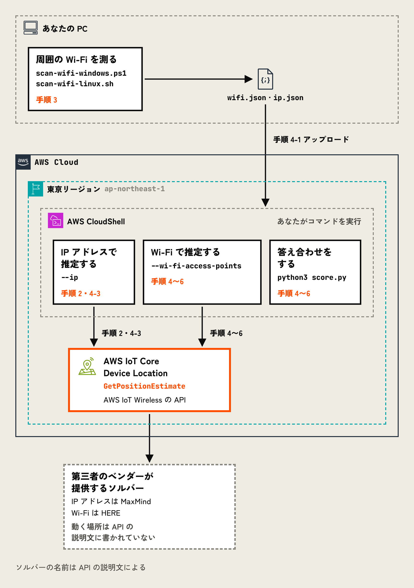
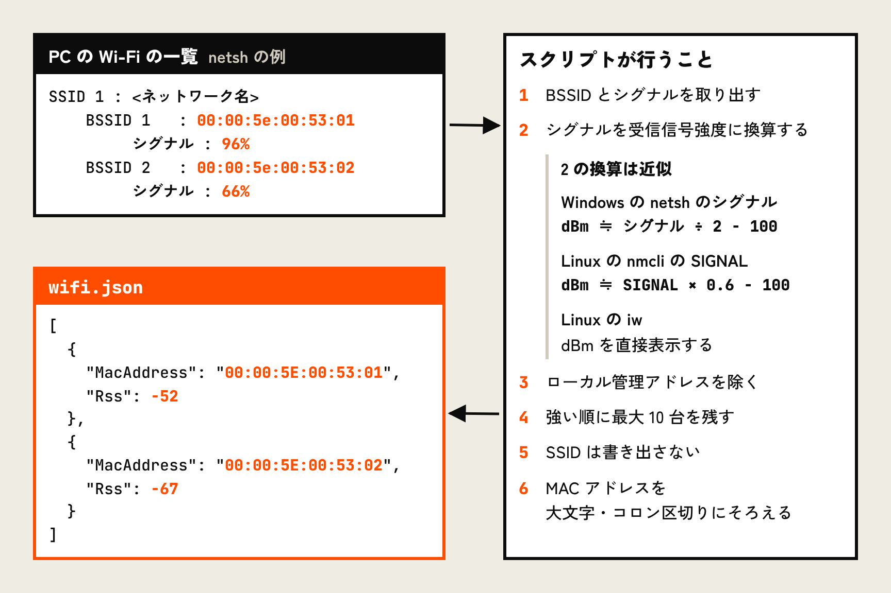
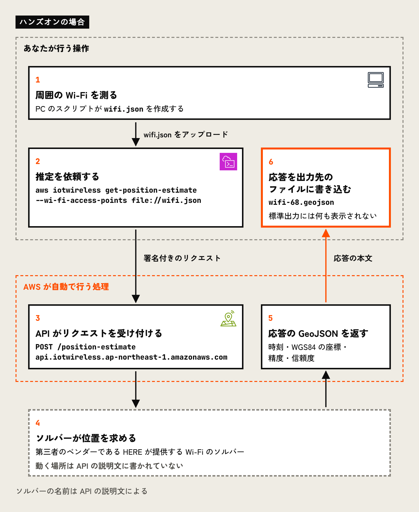
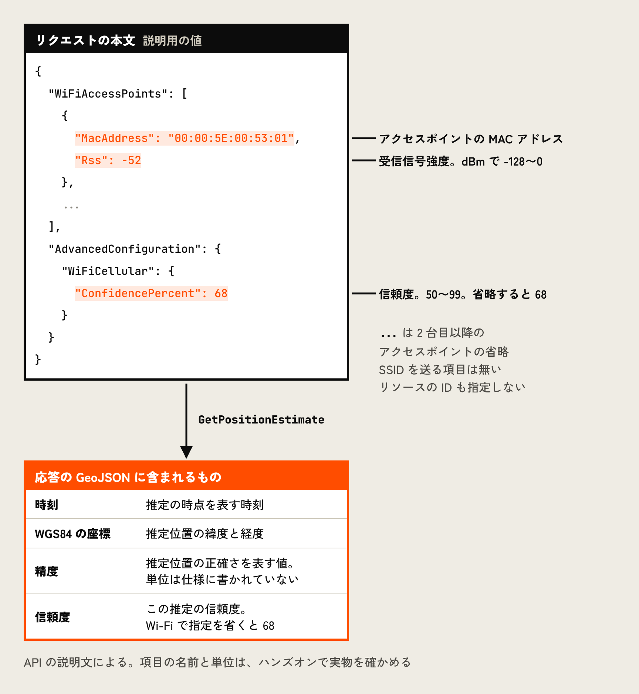
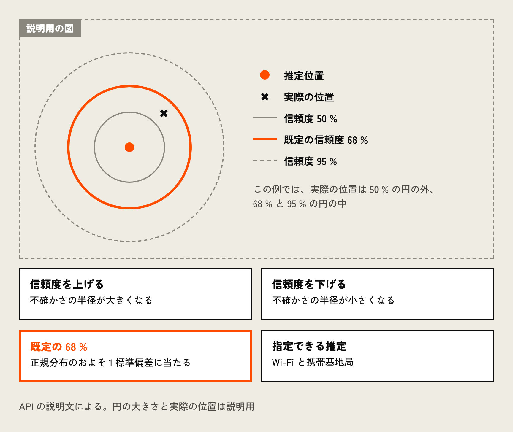
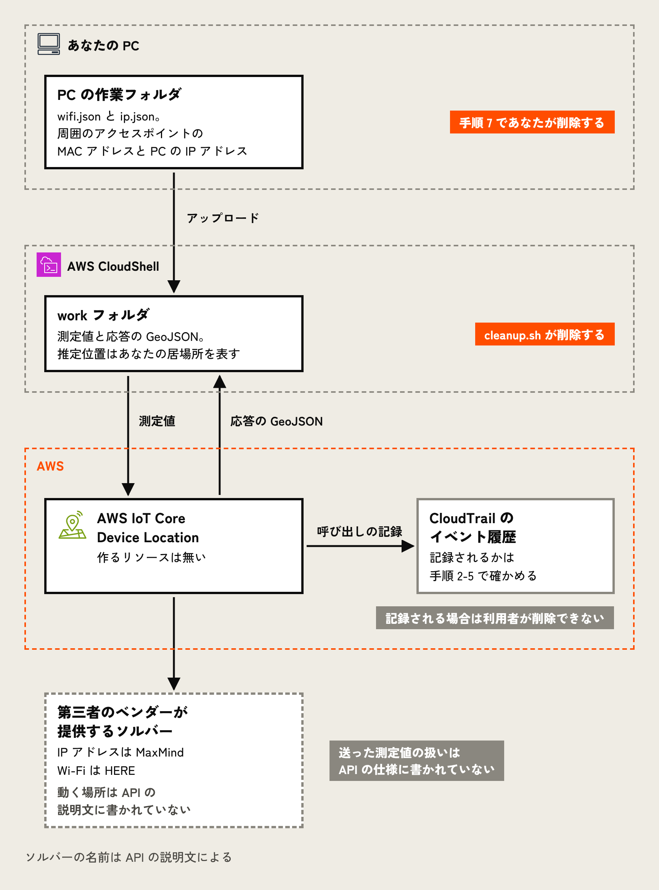

このリポジトリは AWS Deep Cuts の、AWS IoT Core Device Location に関するハンズオンコンテンツです。

<!-- TODO: 記事の公開後に、次の行のリンクを有効にする -->
<!-- AWS IoT Core Device Location の解説記事(Qiita)は[こちら]() -->

解説記事の原稿は [article/aws-iot-core-device-location.md](./article/aws-iot-core-device-location.md) にあります。

> **Note**: AWS IoT Core Device Location は、機器が測った測定値を受け取り、推定した位置を返す AWS IoT Core の機能です。以降、この README では **Device Location** と書きます。このハンズオンは、ブラウザから AWS CLI のコマンドを実行できる AWS CloudShell を使って、東京リージョン（`ap-northeast-1`）で実施します。
> - 位置の推定を依頼する API は `GetPositionEstimate` です。この API は、AWS IoT Core の API ではなく、AWS IoT Wireless の API にあります。そのため、AWS CLI のコマンドは `aws iot` ではなく `aws iotwireless` で始まります。
> - 手順 5 で信頼度を指定するには、AWS CLI の v2.34.35 以降が必要です。CloudShell の AWS CLI は最新版とは限らないため、[前提条件](#前提条件)の手順でバージョンを確認してください。
> - 周囲の Wi-Fi は、Wi-Fi を備えたあなたの PC で測ります。CloudShell は AWS の側で動いているため、あなたの周囲の Wi-Fi を測れません。

> ⚠️ **コストに関する注意**
>
> このハンズオンでは、AWS のリソースを作成しません。料金がかかるのは、`GetPositionEstimate` を呼び出して位置を推定したときだけです。AWS Price List によると、東京リージョンの位置の推定の料金は、最初の 100 万件まで、位置 1 件あたり 0.001 USD です。この README では、安全側に見積もるため、呼び出し 1 回を位置 1 件と数えます。つまり、**1 回の呼び出しごとに最大 0.001 USD** がかかります。
>
> | 呼び出し | 回数 | 概算コストの上限 |
> | --- | --- | --- |
> | 手順どおりに進めた場合 | 最大 10 回 | 約 **$0.010**（約 2 円） |
> | 例: やり直しなどで 100 回呼び出した場合 | 100 回 | **$0.10**（16 円） |
>
> 呼び出しの回数に上限は無いため、費用は呼び出した回数 × 0.001 USD になります。時間に比例して増える料金はありません。作成するリソースが無いため、ハンズオンの途中で手を止めても、放置しても、費用は増えません。1 ドル 160 円で換算しています。内訳は [費用の見積もり](#費用の見積もり) にあります。
>
> 後片付けは、料金を止めるためではなく、あなたの居場所に結び付くファイルを削除するために行います。**検証が終わったら、手順 7 の後片付けを実施してください。**

<!-- 要確認: CloudShell の料金ページで、CloudShell に追加の料金がかからないことを確かめ、確かめられたら上のコストの注意に 1 文足す（iotdl-059） -->

# AWS Deep Cutsとは
AWS Deep Cutsは、AWS の最新のサービスやニッチな機能、または高度にアカデミックな知識を要求するサービスなど、多くの人が知らない 『隠れた名曲 = **Deep Cuts**』 を深くまで掘り下げる技術シリーズです。

このようなサービスはWeb情報も少なく、初学者は気軽にキャッチアップできないのが実情です。

そこで AWS Deep Cuts シリーズでは、**前提知識も含めた分かりやすいサービス解説** と **手順通りに進めれば誰でも再現できるハンズオン** を提供します！

# ハンズオンのゴール

このハンズオンでは、AWS に、あなたの居場所を GPS なしで当ててもらいます。

あなたの PC で周囲の Wi-Fi を測り、その値を CloudShell から Device Location に送ると、Device Location は推定した位置を返します。位置の推定に使う、機器が測った値を **測定値** と呼びます。返ってきた推定位置を、あなたが地図で調べておいた実際の位置と比べて、答え合わせをします。AWS CLI のコマンドを 1 つずつ実行しながら、Device Location について次の 5 つのことを自分の目で確かめます。

| 確かめる内容 | 手順 |
| --- | --- |
| 機器を登録せず、測定値だけを送れば推定位置が返る | 2・4 |
| 応答は画面ではなく、出力先のファイルに書き込まれる | 2 |
| 測定値の種類によって、精度の値が変わるか | 2・4 |
| 信頼度を変えると、応答の値が変わる | 5 |
| 送るアクセスポイントの数や MAC アドレスによって、結果が変わるか | 6 |

「測定値の種類によって、精度の値が変わるか」は、手順 2-2 の CloudShell の IP アドレスの推定と、手順 4-2 の Wi-Fi の推定の、精度の値を比べると確かめられます。任意の手順 4-3 も行うと、同じ場所での IP アドレスの推定と Wi-Fi の推定を比べられます。

各手順では、コマンドを実行する前に、結果を **予想** してください。予想の問いは、各手順の「予想」の欄にあります。答えを、手順 6 の後にある **答え合わせ表** の「予想」の列に書き留めておき、最後に結果と比べます。

用語の意味と仕組みは、解説記事で説明しています。先に記事の「AWS IoT Core Device Locationとは？」と「仕組み」を読んでおくと、各手順で何を確かめているのかが分かりやすくなります。

# ハンズオン手順

以降の手順は、ハンズオン用に用意した AWS アカウントで実施してください。

## 構築するアーキテクチャ



このハンズオンで AWS の中に作成するリソースはありません。図の上段はあなたの PC、中段は AWS の中で動く CloudShell、下段は Device Location です。AWS の枠の下には、第三者のベンダーが提供するソルバーがあります。図の番号は、この README の手順の番号です。

- あなたは PC でスクリプトを実行し、周囲の Wi-Fi を測って、測定値を `wifi.json` に保存します。手順 3 で行います。
- あなたは `wifi.json` を CloudShell にアップロードします。手順 4-1 で行います。
- あなたは CloudShell から AWS CLI の `aws iotwireless get-position-estimate` コマンドを実行し、`GetPositionEstimate` API を呼び出します。手順 2 では CloudShell の IP アドレスを、手順 4〜6 では Wi-Fi の測定値を送ります。
- Device Location は、測定値の種類ごとに、第三者のベンダーが提供するソルバーで位置を求めます。ソルバーは、測定値から位置を計算する仕組みです。API の説明文によると、IP アドレスは MaxMind、Wi-Fi は HERE が提供するソルバーで解決されます。ソルバーが動く場所は、API の説明文に書かれていません。
- あなたは CloudShell で `score.py` を実行し、推定位置と実際の位置を比べます。`score.py` は AWS を呼び出しません。

この README では、Device Location のサービスが AWS の中で自動で行う処理を「AWS が〜する」と書きます。あなたが PC と CloudShell で行う操作は「あなたが〜する」と書きます。

## 前提条件

- AWS CloudShell を **東京リージョン** で開くこと
- AWS CLI が v2.34.35 以降であること。v2.34.35 は、手順 5 で使う信頼度の指定 `--advanced-configuration` が追加された版です。手順 1 の `setup.sh` が、この AWS CLI が信頼度の指定に対応しているかを確かめます。次のコマンドでも、バージョンを確認できます。

  ```bash
  aws --version
  ```

  バージョンが v2.34.35 より古い場合は、次の手順で更新してください。

  <details>
  <summary>AWS CLI の最新版をホームディレクトリにインストールする手順</summary>

  CloudShell の AWS CLI は、最新版より数バージョン古いことがあります。CloudShell のホームディレクトリは次回以降のセッションでも残るため、ここに最新版をインストールします。

  ```bash
  curl -sS https://awscli.amazonaws.com/awscli-exe-linux-x86_64.zip -o /tmp/awscliv2.zip
  unzip -q -o /tmp/awscliv2.zip -d /tmp
  /tmp/aws/install --install-dir "$HOME/.local/aws-cli" --bin-dir "$HOME/.local/bin" --update
  export PATH="$HOME/.local/bin:$PATH"
  aws --version
  ```

  `export PATH=...` の行は、CloudShell のタブを新しく開くたびに実行してください。
  </details>

- CloudShell を開いた IAM ユーザーまたは IAM ロールに、`iotwireless:GetPositionEstimate` の権限があること。`AdministratorAccess` 相当の権限で実施するのが簡単です。

<details>
<summary>最小権限に近い IAM ポリシーの例</summary>

CloudShell を使う権限は、このポリシーとは別に必要です。たとえば AWS 管理ポリシーの `AWSCloudShellFullAccess` をアタッチします。手順 8 で請求書を確認するには、Billing and Cost Management の請求書を閲覧する権限も必要です。

```json
{
  "Version": "2012-10-17",
  "Statement": [
    { "Sid": "DeviceLocation", "Effect": "Allow", "Action": "iotwireless:GetPositionEstimate", "Resource": "*" },
    { "Sid": "CloudTrailEventHistory", "Effect": "Allow", "Action": "cloudtrail:LookupEvents", "Resource": "*" }
  ]
}
```

<!-- 要確認: C-11。Service Authorization Reference で iotwireless:GetPositionEstimate のリソースの種類と条件キーを確かめ、Resource を直す -->

2 つ目のステートメント `CloudTrailEventHistory` は、手順 2-5 で CloudTrail のイベント履歴を確認する場合だけ必要です。手順 1 の `setup.sh` は、AWS アカウントの ID を表示するために `aws sts get-caller-identity` を実行します。`GetCallerIdentity` の API の説明文によると、この操作には IAM の権限が必要ありません。そのため、このポリシーには含めていません。
</details>

- Wi-Fi を備えたあなたの PC があること。PC の OS によって、周囲の Wi-Fi の測り方が異なります。

  | PC の OS | 周囲の Wi-Fi の測り方 | 行う手順 |
  | --- | --- | --- |
  | Windows 10 / 11 | PowerShell でスクリプト `scan-wifi-windows.ps1` を実行する | すべて |
  | Linux | NetworkManager の `nmcli` か、`iw` を使うスクリプト `scan-wifi-linux.sh` を実行する | すべて |
  | macOS | スクリプトは用意していません。接続中のアクセスポイント 1 台の値を画面で読み取り、CloudShell でファイルに書き込む | 1・2・3-1・3-2 の「Mac の場合」・4-1・4-2・4-4・5・6-3・7・8 |

  Mac の場合は、1 台のアクセスポイントだけで推定します。そのため、PC の IP アドレスで推定する手順 4-3 と、アクセスポイントの数を減らす手順 6-1・6-2 は行いません。

  <!-- 要確認: C-17・C-28。Mac で接続中のアクセスポイントの MAC アドレスと受信信号強度を画面で読み取れるか。確かめられない場合は、Mac の読者には手順 2・5-3・6-3 だけを案内するように、この表と手順 3-2 を書き直す -->
  <!-- 要確認: C-30。筆者が手順 3〜6 を実機で確かめた PC の OS を記録し、確かめていない OS があれば「筆者は〇〇の実機では確かめていません」とここに書く -->

- Windows 11 では、`netsh` で周囲の Wi-Fi の一覧を表示するのに、位置情報の設定を有効にする必要がある場合があります。詳しくは手順 3-2 で説明します。
- 周囲の Wi-Fi を測るのは、自宅や自分の職場など、**あなたが使ってよい場所** に限ること

以降、AWS を呼び出すコマンドは、東京リージョンで開いた [CloudShell](https://docs.aws.amazon.com/cloudshell/latest/userguide/welcome.html) で実行してください。手順 3 のコマンドだけは、あなたの PC で実行します。

## １．事前準備

このハンズオンでは、AWS のリソースを作成しません。`GetPositionEstimate` は、AWS IoT Core に登録したモノや無線デバイスのような AWS のリソースを指定せずに、測定値だけを送って呼び出す API です。API の仕様にも、リソースの ID を取る項目はありません。

`setup.sh` が行うのは、次の 4 つの確認と準備だけです。料金のかかる呼び出しはしません。

| 段 | `setup.sh` が行うこと |
| --- | --- |
| `[1/4]` | 必要なコマンド `aws`・`python3`・`curl`・`jq` があるかを確かめる |
| `[2/4]` | AWS CLI が信頼度の指定 `--advanced-configuration` に対応しているかを確かめる |
| `[3/4]` | AWS アカウントの ID を表示する |
| `[4/4]` | 測定値と応答を保存する work フォルダと、変数を保存する `handson.env` を作成する |

`jq` は、JSON を読み取って加工するコマンドです。手順 4 と手順 6 で使います。

```bash
# このリポジトリをクローン
git clone https://github.com/AWS-Deep-Cuts/aws-iot-core-device-location
cd aws-iot-core-device-location/hands-on

# セットアップスクリプトの実行
bash ./setup.sh

# 以下の文言が表示されればセットアップ成功です
# ✅ セットアップが完了しました！
```

`setup.sh` は、以降の手順で使う変数を `handson.env` に保存しました。次のコマンドでこのファイルを読み込むと、以降のコマンドで変数として使えます。

```bash
source ./handson.env
```

| 変数 | 中身 | 使う手順 |
| --- | --- | --- |
| `REGION` | リージョン `ap-northeast-1` | 2・4・5・6 |
| `HANDSON_DIR` | CloudShell の `hands-on` フォルダの場所 | 2・4・5・6 |
| `WORK_DIR` | CloudShell の work フォルダ `hands-on/work` の場所。測定値と応答の GeoJSON を保存する | 2〜6 |

この README では、CloudShell の `hands-on/work` フォルダを **CloudShell の work フォルダ** と呼びます。手順 3 であなたの PC に作成するフォルダとは別のものです。

> **Note**: CloudShell は、操作しない時間が続くとセッションが終了し、変数が消えます。その場合は、次のコマンドを実行してから続きの手順に進んでください。
>
> ```bash
> cd ~/aws-iot-core-device-location/hands-on && source ./handson.env
> ```
>
> 前提条件で AWS CLI をホームディレクトリにインストールした場合は、`export PATH="$HOME/.local/bin:$PATH"` も実行します。手順 2 で設定する変数 `MY_IP` は `handson.env` に保存されないため、手順 2 の途中でセッションが終了した場合は、手順 2-1 のコマンドから実行し直してください。

<!-- 画面写真: CloudShell の setup.sh の出力。「この AWS CLI は信頼度の指定（--advanced-configuration）に対応しています」と「AWS のリソースは作成していません」の 2 行を枠で囲む。アカウント ID はぼかす -->

`setup.sh` の `[2/4]` の確認では、範囲外の信頼度 30 をわざと指定して `get-position-estimate` を実行しています。AWS CLI は、リクエストを AWS に送る前に、入力が API の仕様に合うかを確かめます。この README では、これを **CLI の検査** と呼びます。CLI の検査で止まると、エラーの表示に `ParamValidation` が含まれ、リクエストは AWS に送られません。信頼度の指定に対応した AWS CLI は、API の仕様の下限 50 と比べて検査するため、30 を CLI の検査で止めます。古い AWS CLI には `--advanced-configuration` というオプションが無いため、別のエラーで止まります。`setup.sh` は、この違いで AWS CLI の版を見分けています。

次のコマンドで、work フォルダが、あなただけが読み書きできる設定で作成されたことを確かめます。結果の左端が `drwx------` であれば、ほかの利用者はこのフォルダを読めません。

```bash
ls -ld "${WORK_DIR}"
```

> **この手順で確かめること**
> - **やること**: `setup.sh` の出力と、上の `ls -ld` の結果を確認します。
> - **期待する結果**: `setup.sh` の出力に「この AWS CLI は信頼度の指定（--advanced-configuration）に対応しています」と「AWS のリソースは作成していません」が表示されています。`ls -ld` の結果の左端が `drwx------` です。
> - **ここから分かること**: Device Location を使うのに、AWS の側で準備するものはありません。測定値と応答は、あなただけが読み書きできる CloudShell の work フォルダに保存します。`setup.sh` の AWS CLI の確認は CLI の検査で止まるため、リクエストは AWS に送られず、料金はかかりません。

## ２．CloudShell の IP アドレスで位置を推定する

最初は、個人に結び付かない値で 1 回呼び出します。CloudShell がインターネットに接続するときの IP アドレスは、AWS が持つアドレスです。あなたの居場所を表す値ではありません。API の説明文によると、IP アドレスの測定値は、MaxMind が提供するソルバーで解決されます。

この README の `get-position-estimate` のコマンドは、すべて次の決まりで書きます。

- 応答を書き込む **出力先のファイル** の名前を、コマンド名 `get-position-estimate` の直後に書きます。出力先のファイル名を `--wi-fi-access-points` より後ろに書くと、間に `--region` があっても、コマンドの最後に書いても、AWS CLI はファイル名をアクセスポイントの一覧の要素として読みます。その結果、`the following arguments are required: outfile` のエラーで止まります。AWS CLI 2.39.0 で確かめた結果です。<!-- 要確認: 著者が CloudShell の AWS CLI で、引数の順序の挙動を確かめる（evidence/cli-argorder-revision.txt）。確かめたら、確かめた版と「筆者が確かめた」を書く -->
- `--region "${REGION}"` を必ず付けます。
- 出力先のファイルは、CloudShell の work フォルダに保存します。
- あなたの PC の MAC アドレスや IP アドレスのような、個人に結び付く値は、コマンドの文字列に書きません。ファイルに保存して `file://` で渡します。シェルの履歴に残さないためです。

### 2-1. CloudShell の IP アドレスを調べる

`checkip.amazonaws.com` は、接続してきた側の IP アドレスを返すサービスです。CloudShell から接続すると、CloudShell の IP アドレスが返ります。次のコマンドで、その値を変数 `MY_IP` に代入します。

```bash
MY_IP=$(curl -s https://checkip.amazonaws.com)
```

次のコマンドは、`MY_IP` が空のときだけ、`:-` の後ろの文を表示します。IP アドレスが表示されれば、取得できています。

```bash
echo "${MY_IP:-⚠️ IP アドレスを取得できませんでした。1 つ前のコマンドを実行し直してください}"
```

`MY_IP` が空のまま手順 2-2 に進むと、IP アドレスが空のリクエストが AWS に送られます。API の仕様では、IP アドレスの形に制約が無いため、CLI の検査では止まりません。

### 2-2. 位置の推定を依頼する

> **予想**: CloudShell の IP アドレスから推定した位置は、どこになるでしょうか。

CloudShell の IP アドレスを測定値として送り、Device Location に位置の推定を依頼します。このハンズオンで最初の、料金のかかる呼び出しです。

```bash
aws iotwireless get-position-estimate "${WORK_DIR}/cloudshell-ip.geojson" \
  --ip IpAddress="${MY_IP}" \
  --region "${REGION}"
```

| パラメータ | 指定した値 | 意味 |
| --- | --- | --- |
| 出力先のファイル | `cloudshell-ip.geojson` | 応答を書き込むファイル。コマンド名の直後に書く |
| `--ip` | `IpAddress` に CloudShell の IP アドレス | IP アドレスの測定値 |
| `--region` | `ap-northeast-1` | 呼び出すリージョン |

このコマンドは、画面に何も表示せずに終わります。

このコマンドを実行すると、AWS の中では次のことが起きます。

1. AWS CLI は、リクエストを `api.iotwireless.ap-northeast-1.amazonaws.com` に送ります。このリクエストは **署名付きのリクエスト** です。AWS CLI は、CloudShell の認証情報から計算した署名をリクエストに付けて送ります。AWS は、この署名で、誰が送ったリクエストかを確かめます。
2. AWS IoT Wireless の API が、リクエストを受け付けます。
3. IP アドレスの測定値は、MaxMind が提供するソルバーで解決されます。
4. AWS は、推定位置を GeoJSON の形式で返します。GeoJSON は、地理的なデータを JSON で表すための形式です。
5. AWS CLI は、応答の GeoJSON を、画面ではなく出力先のファイルに書き込みます。API の仕様では、応答の本文そのものが GeoJSON です。AWS CLI は、このように応答の本文がデータそのものである API では、応答を画面に表示せず、指定したファイルに書き込みます。

### 2-3. 応答のファイルを確認する

CloudShell の work フォルダに、出力先のファイルが作成されたことを確認します。

```bash
ls -l "${WORK_DIR}"
```

ファイルの中身を、読みやすく整えて表示します。`python3 -m json.tool` は、JSON に改行と字下げを加えて表示するコマンドです。

```bash
python3 -m json.tool "${WORK_DIR}/cloudshell-ip.geojson"
```

API の説明文によると、応答の GeoJSON には、時刻、WGS84 の座標、精度、信頼度が含まれます。WGS84 は、緯度と経度を表すときに使う世界共通の基準の 1 つです。表示された項目の中から、精度の値を探し、答え合わせ表の 2-2 の行の「精度の値」の列に書き留めてください。手順 4-2 の Wi-Fi の推定の精度の値と比べます。

どの項目が精度か分からない場合は、次のコマンドで、手順 4-4 で使う `score.py` に、精度の値と項目の名前を表示させます。`score.py` は AWS を呼び出しません。CloudShell の IP アドレスの推定は、あなたの居場所の推定ではないため、`score.py` は実際の位置を尋ねません。

```bash
python3 "${HANDSON_DIR}/score.py" "${WORK_DIR}/cloudshell-ip.geojson"
```

<!-- 要確認: C-03。著者が CloudShell で確かめた応答の実物を見て、項目名・精度の単位・座標の順序をここに書く。座標を説明用の値に置き換えた出力の形の例を、「出力の形の例。値は説明用です」と断って載せる -->

<!-- 画面写真: CloudShell の python3 -m json.tool の出力。応答の項目を枠で囲む。CloudShell の推定位置のため、隠すものは無い -->

座標が、どの場所を指しているかを確かめるには、あなたの PC の地図のサービスで、表示された緯度と経度を開きます。CloudShell が動いている場所の推定のため、あなたの居場所とは関係がありません。

### 2-4. AWS CLI が送ったリクエストを確かめる

手順 2-2 で AWS CLI が AWS に送ったリクエストの中身を確かめるため、同じ依頼をもう 1 回実行します。料金のかかる 2 回目の呼び出しです。`--debug` は、AWS CLI の動作の記録を画面に表示するオプションです。記録には認証の値も含まれるため、`grep` で、宛先・パス・本文の 3 つだけを取り出して表示します。記録はファイルに保存しません。

```bash
aws iotwireless get-position-estimate "${WORK_DIR}/cloudshell-ip-2.geojson" \
  --ip IpAddress="${MY_IP}" --region "${REGION}" --debug 2>&1 \
  | grep -oE "Endpoint provider result: \S+|'url_path': '[^']*'|'body': b'[^']*'" | LC_ALL=C sort -u
```

期待する出力の形は次のとおりです。IP アドレスは説明用の値です。

```text
'body': b'{"Ip": {"IpAddress": "192.0.2.10"}}'
'url_path': '/position-estimate'
Endpoint provider result: https://api.iotwireless.ap-northeast-1.amazonaws.com
```

<!-- 要確認: C-23。CloudShell の AWS CLI の版でも、この 3 行が同じ形で表示されるか -->

| 行 | 意味 |
| --- | --- |
| `'body': ...` | AWS CLI が送ったリクエストの本文。`--ip` の値が JSON の `Ip` になっている |
| `'url_path': ...` | リクエストのパス `/position-estimate`。HTTP の POST で送られる |
| `Endpoint provider result: ...` | リクエストの宛先 |

### 2-5. CloudTrail で呼び出しの記録を確かめる

<!-- 要確認: C-22。CloudTrail のイベント履歴に GetPositionEstimate が記録されるか、イベントソースの名前、リクエストのパラメータに IP アドレスが残るかを確かめる。記録されない場合は、この 2-5 を削り、前提条件のポリシーの例の CloudTrailEventHistory のステートメントと、手順 3・7 の CloudTrail の記述も削る -->

AWS CloudTrail は、AWS の API の呼び出しを記録するサービスです。CloudTrail のイベント履歴では、直近の API の呼び出しの記録を、マネジメントコンソールで確認できます。手順 2-2 と手順 2-4 の呼び出しが記録されているかを確かめます。

1. マネジメントコンソールで CloudTrail を開き、リージョンが東京であることを確認します。
2. 左のメニューから「イベント履歴」を選びます。
3. 検索の属性で「イベント名」を選び、`GetPositionEstimate` を入力します。
4. 表示された行を開き、記録の中身を確認します。

<!-- 画面写真: CloudTrail のイベント履歴。イベント名 GetPositionEstimate の 2 行と、イベントソースの列を枠で囲む。アカウント ID と IP アドレスはぼかす -->

記録の中に、送った IP アドレスのようなリクエストのパラメータが含まれているかを確認してください。含まれている場合、手順 4 以降で送る Wi-Fi の測定値も、イベント履歴に記録されると考えられます。イベント履歴の記録は一定の期間残り、利用者は削除できません。

<!-- 要確認: C-22。イベント履歴の記録が残る期間を、著者が確かめた値で上の段落に書く -->

> **この手順で確かめること**
> - **やること**: 手順 2-2 のコマンドが画面に何も表示しなかったことと、手順 2-3 の `ls` と `json.tool` の結果を確認します。手順 2-4 の 3 行を確認します。
> - **期待する結果**: 手順 2-2 のコマンドは、何も表示せずに終わります。CloudShell の work フォルダに `cloudshell-ip.geojson` があり、中身は JSON です。手順 2-4 では、宛先が `api.iotwireless.ap-northeast-1.amazonaws.com`、パスが `/position-estimate`、本文が `{"Ip": {"IpAddress": "..."}}` の形です。
> - **ここから分かること**: `aws iotwireless` のコマンドは、AWS IoT Core ではなく、AWS IoT Wireless の API の宛先にリクエストを送っています。リクエストに含まれるのは測定値だけで、AWS のリソースの ID は含まれていません。応答は、画面ではなく出力先のファイルに書き込まれます。

<!-- 要確認: C-02。CloudShell の AWS CLI でも、応答が出力先のファイルに書き込まれ、画面に何も表示されないか -->

## ３．PC で周囲の Wi-Fi を測る

CloudShell は AWS の側で動いているため、あなたの周囲の Wi-Fi を測れません。そこで、Wi-Fi を備えたあなたの PC で周囲の Wi-Fi を測り、測定値をファイルに保存します。この手順のコマンドは、CloudShell ではなく、あなたの PC で実行します。

Wi-Fi の測定値は、周囲の **アクセスポイント** ごとの、**MAC アドレス** と **受信信号強度** の組です。アクセスポイントは Wi-Fi の電波を出す機器で、家庭の無線 LAN のルーターもその 1 つです。MAC アドレスはその機器の識別番号です。受信信号強度は受け取った電波の強さで、単位は dBm です。API の仕様では、受信信号強度を -128〜0 の整数で送ります。netsh と nmcli の出力では、MAC アドレスは BSSID と表示されます。測定値には、アクセスポイントの位置は含まれません。

> **Note**: 測定値の扱いについて
> - 周囲の Wi-Fi を測るのは、自宅や自分の職場など、あなたが使ってよい場所だけにしてください。
> - 測定値には、あなたのルーターだけでなく、近隣のアクセスポイントの MAC アドレスも含まれます。測定値のファイル、推定位置、画面写真を、公開したり他人に渡したりしないでください。
> - API の説明文によると、送った測定値は、第三者のベンダーが提供するソルバーで解決されます。測定値を送りたくない場合は、手順 2・5-3・6-3 だけを行ってください。この 3 つの手順では、あなたの測定値を送りません。

<!-- 要確認: C-22。手順 2-5 で、CloudTrail のイベント履歴にリクエストのパラメータが残ると分かった場合は、上の Note に「送った測定値は、CloudTrail のイベント履歴に一定の期間残り、利用者は削除できません」の 1 文を足す -->

### 3-1. 測る場所を決めて実際の位置を調べておく

手順 4-4 の答え合わせでは、推定位置を **実際の位置** と比べます。実際の位置は、あなたが周囲の Wi-Fi を測る場所の、本当の緯度と経度です。測る前に、次のように調べておきます。

1. 周囲の Wi-Fi を測る場所を決めます。自宅や自分の職場など、あなたが使ってよい場所にします。
2. PC の地図のサービスで、あなたがいる建物や部屋の位置を、住所や周囲の道路をもとに探します。
3. 見つけた地点を地図の上で指定して、その地点の緯度と経度を読み取ります。操作は、地図のサービスによって異なります。
4. 読み取った緯度と経度を、紙などにメモします。メモはファイルに保存しません。

地図の現在地の表示は使いません。現在地の表示も、この README で確かめる位置の推定の結果だからです。推定の結果を基準にすると推定どうしを比べることになるため、ずれや円の中か外かの判定に意味がなくなります。

地図の上で地点を指定するときには、数 m の読み取りの誤差が生じます。手順 4 以降で、ずれの値が数 m しか違わない場合は、この読み取りの誤差の範囲と考えてください。

### 3-2. PC の作業フォルダを作成して周囲の Wi-Fi を測る

最初に、あなたの PC のホームフォルダの下に `iotdl-handson` フォルダを作成して、移動します。この README では、このフォルダを **PC の作業フォルダ** と呼びます。この手順で PC に作成するファイルは、すべてこのフォルダに保存し、手順 7 でフォルダごと削除します。

Windows の場合は、PowerShell で次の 2 つのコマンドを実行します。

```powershell
New-Item -ItemType Directory -Force -Path "$HOME\iotdl-handson"
```

```powershell
Set-Location "$HOME\iotdl-handson"
```

Linux の場合は、ターミナルで次のコマンドを実行します。

```bash
mkdir -p ~/iotdl-handson && cd ~/iotdl-handson
```

続けて、あなたの PC の OS に合わせて、次のどれか 1 つを行います。

#### Windows の場合

**1. 位置情報の設定を確かめる**

Windows 11 では、`netsh` で周囲の Wi-Fi の一覧を表示するのに、位置情報の設定を有効にする必要がある場合があります。「設定」→「プライバシーとセキュリティ」→「位置情報」の画面で、位置情報の設定を確認します。設定を変える場合は、変える前の状態をメモしておき、手順 7 で元に戻してください。

<!-- 要確認: C-26（最優先）。Windows 11 で netsh wlan show networks mode=bssid に位置情報の設定が要るか。要る場合に表示される文、必要な設定の項目の名前と画面の開き方、Windows 10 でも要るかを確かめて、この段落を書き直す -->

**2. スクリプトを取得する**

```powershell
Invoke-WebRequest -UseBasicParsing -Uri https://raw.githubusercontent.com/AWS-Deep-Cuts/aws-iot-core-device-location/main/hands-on/pc/scan-wifi-windows.ps1 -OutFile scan-wifi-windows.ps1
```

<!-- 要確認: main ブランチへのマージ後に、この raw の URL でスクリプトを取得できるか -->

取得できない場合は、ブラウザで GitHub のこのリポジトリを開き、`hands-on/pc/scan-wifi-windows.ps1` をダウンロードして、PC の作業フォルダに保存してください。

**3. スクリプトの前に周囲の Wi-Fi の一覧を確認する**

スクリプトが読み取る元の一覧を、先に確認します。

```powershell
netsh wlan show networks mode=bssid
```

出力の形の例は次のとおりです。値は説明用です。実際の出力には、他の行も含まれます。

```text
SSID 1 : <ネットワーク名>
    BSSID 1   : 00:00:5e:00:53:01
         シグナル : 96%
    BSSID 2   : 00:00:5e:00:53:02
         シグナル : 66%
```

`BSSID` の行が、アクセスポイントの MAC アドレスです。`シグナル` の行は百分率で、受信信号強度の dBm ではありません。Microsoft の WLAN API のドキュメントでは、信号の品質の 0 % を -100 dBm、100 % を -50 dBm とし、その間を線形に補間すると説明しています。netsh の表示がこの値と同じかは、ドキュメントに書かれていません。そのため、スクリプトは「dBm ≒ シグナル ÷ 2 − 100」の式で近似します。上の例の 96 % は -52 dBm、66 % は -67 dBm になります。

<!-- 画面写真: Windows の netsh wlan show networks mode=bssid の出力。SSID と BSSID の値はすべてぼかし、「BSSID」と「シグナル」の行の名前を枠で囲む -->

**4. スクリプトを実行する**

```powershell
powershell -ExecutionPolicy Bypass -File .\scan-wifi-windows.ps1 -IncludeIp
```

| 指定 | 意味 |
| --- | --- |
| `-ExecutionPolicy Bypass` | このコマンドで起動する PowerShell だけで、スクリプトの実行を許可する。PC の設定は変えない |
| `-File .\scan-wifi-windows.ps1` | 実行するスクリプト |
| `-IncludeIp` | 任意の指定。手順 4-3 で使う PC の IP アドレスを `ip.json` に保存する。手順 4-3 を行わない場合は付けない |

スクリプトが行うことは、次の図のとおりです。



1. netsh の出力から、BSSID とシグナルを取り出します。
2. シグナルを、受信信号強度の dBm に換算します。
3. ローカル管理アドレスを除きます。**ローカル管理アドレス** は、機器が自分で決めた MAC アドレスで、スマートフォンのテザリングなどで使われることが多いものです。機器が自分で決めるアドレスのため、ソルバーがその場所を知っているとは限りません。送る値を、位置の推定に使われる見込みのあるアドレスに絞るために除きます。<!-- 要確認: iotdl-078。ローカル管理アドレスが位置の推定に使われないかは、一次情報で確かめていない -->
4. 受信信号強度の強い順に並べ、最大 10 台を残します。
5. SSID は書き出しません。SSID は、Wi-Fi のネットワークの名前です。API の仕様にも、SSID を送る項目はありません。
6. MAC アドレスを、大文字のコロン区切りの形にそろえます。

スクリプトは、MAC アドレスの前半 4 つを `**` で伏せた一覧と、保存したアクセスポイントの台数を表示します。

<!-- 画面写真: scan-wifi-windows.ps1 の出力。MAC アドレスの前半を伏せて表示した一覧と、作成した wifi.json の台数を枠で囲む -->

#### Linux の場合

**1. 周囲の Wi-Fi の一覧を確認する**

スクリプトが読み取る元の一覧を、先に確認します。次のコマンドは、NetworkManager の `nmcli` で、周囲のアクセスポイントの一覧を表示します。sudo は使いません。

```bash
nmcli -f BSSID,SIGNAL,CHAN device wifi list
```

出力の形の例は次のとおりです。値は説明用です。

```text
BSSID              SIGNAL  CHAN
00:00:5E:00:53:01  80      36
00:00:5E:00:53:02  55      6
```

`BSSID` の列が、アクセスポイントの MAC アドレスです。`SIGNAL` の列は百分率で、受信信号強度の dBm ではありません。NetworkManager のソースコードでは、dBm を -100〜-40 の範囲に丸めてから百分率に変換しています。そのため、スクリプトは「dBm ≒ SIGNAL × 0.6 − 100」の式で近似します。上の例の 80 は -52 dBm、55 は -67 dBm になります。-40 dBm より強い電波は、すべて 100 と表示されるため、区別できません。

<!-- 画面写真: nmcli の出力。BSSID の値はすべてぼかし、BSSID と SIGNAL の列の名前を枠で囲む -->

**2. sudo を使う場合は iw の一覧も確認する**

sudo を使える場合は、受信信号強度を dBm で直接表示する `iw` の一覧も確認できます。まず、無線のインターフェースの名前を調べます。

```bash
iw dev
```

`Interface` の行に表示された名前を使って、次のコマンドを実行します。ここでは、説明用の例として `wlan0` と書いています。

```bash
sudo iw dev wlan0 scan | grep -E '^BSS|signal:'
```

`BSS` の行がアクセスポイントの MAC アドレス、`signal:` の行が受信信号強度の dBm です。

<!-- 要確認: R13。iw がインストールされていない環境での案内と、iw dev wlan0 scan に root の権限が要るか -->

**3. スクリプトを取得して実行する**

```bash
curl -sSO https://raw.githubusercontent.com/AWS-Deep-Cuts/aws-iot-core-device-location/main/hands-on/pc/scan-wifi-linux.sh
```

<!-- 要確認: main ブランチへのマージ後に、この raw の URL でスクリプトを取得できるか -->

取得できない場合は、ブラウザで GitHub のこのリポジトリを開き、`hands-on/pc/scan-wifi-linux.sh` をダウンロードして、PC の作業フォルダに保存してください。

次の 2 つのコマンドのうち、どちらか 1 つを実行します。1 つ目は sudo を使い、`iw` で受信信号強度の dBm を直接取得します。2 つ目は sudo を使わず、`nmcli` の SIGNAL から dBm を近似します。どちらも `--with-ip` は任意の指定で、手順 4-3 で使う PC の IP アドレスを `ip.json` に保存します。

```bash
sudo bash ./scan-wifi-linux.sh --with-ip
```

```bash
bash ./scan-wifi-linux.sh --with-ip
```

スクリプトが行うことは、Windows の場合の図と同じです。sudo を付けて実行した場合も、スクリプトは作成したファイルの所有者を、あなたのユーザーに戻します。

#### Mac の場合

Mac 用のスクリプトは用意していません。接続中のアクセスポイント 1 台の MAC アドレスと受信信号強度を画面で読み取り、紙にメモします。メモは PC のファイルにしません。手順 4-1 で、CloudShell の中で `wifi.json` に書き込みます。

<!-- 要確認: C-17・C-28。Option キーを押しながらメニューバーの Wi-Fi のアイコンをクリックすると、接続中のネットワークの BSSID と RSSI が表示されるか。BSSID の表示に位置情報サービスの許可が要るか。RSSI の単位が dBm か。確かめた方法を、ここに手順として書く。確かめられない場合は、この小見出しを削り、Mac の読者には手順 2・5-3・6-3 だけを案内する -->

Mac の場合は、1 台のアクセスポイントだけで推定します。そのため、手順 4 以降で、精度の値が大きくなるか、エラーになる可能性があります。

### 3-3. wifi.json の中身を確認する

Windows と Linux の場合は、PC の作業フォルダで、スクリプトが作成した `wifi.json` の中身を表示します。

Windows の場合は、次のコマンドを実行します。

```powershell
Get-Content .\wifi.json
```

Linux の場合は、次のコマンドを実行します。

```bash
cat wifi.json
```

出力の形の例は次のとおりです。値は説明用です。

```json
[
  {
    "MacAddress": "00:00:5E:00:53:01",
    "Rss": -52
  },
  {
    "MacAddress": "00:00:5E:00:53:02",
    "Rss": -67
  }
]
```

> **この手順で確かめること**
> - **やること**: `wifi.json` の要素の数と、各要素の項目を確認します。
> - **期待する結果**: 要素は最大 10 個です。各要素の項目は `MacAddress` と `Rss` の 2 つだけで、`Rss` は 0 以下の整数です。SSID は含まれていません。
> - **ここから分かること**: Wi-Fi の測定値は、MAC アドレスと受信信号強度の組だけで、アクセスポイントの位置は含まれていません。それでも位置が求まるのであれば、ソルバーの側が、MAC アドレスからアクセスポイントの場所を知っていることになると筆者は考えます。

## ４．Wi-Fi の測定値で位置を推定して答え合わせをする

この手順から、CloudShell に戻ります。手順 3 で測った Wi-Fi の測定値を CloudShell に用意し、Device Location に位置の推定を依頼して、実際の位置と答え合わせをします。

### 4-1. 測定値のファイルを CloudShell に用意する

#### Windows と Linux の場合

CloudShell の画面の右上の「アクション」から「ファイルのアップロード」を選び、PC の作業フォルダの `wifi.json` を選びます。手順 4-3 を行う場合は、`ip.json` も同じ方法でアップロードします。アップロードしたファイルは、CloudShell のホームディレクトリに保存されます。

<!-- 要確認: C-24。「アクション」と「ファイルのアップロード」のボタンの名前と、アップロード先がホームディレクトリであること -->

<!-- 画面写真: CloudShell の「アクション」のメニュー。「ファイルのアップロード」を枠で囲む -->

アップロードした `wifi.json` を、CloudShell の work フォルダに移します。`mv -i` は、移動先に同じ名前のファイルがあるときに、上書きしてよいかを尋ねます。

```bash
mv -i ~/wifi.json "${WORK_DIR}/"
```

手順 4-3 を行う場合は、`ip.json` も移します。

```bash
mv -i ~/ip.json "${WORK_DIR}/"
```

#### Mac の場合

雛形のファイル `example-wifi.json` を、CloudShell の work フォルダに `wifi.json` という名前でコピーします。雛形には、説明用の MAC アドレス 1 台分の値が書かれています。

```bash
cp "${HANDSON_DIR}/example-wifi.json" "${WORK_DIR}/wifi.json"
```

CloudShell のテキストエディタ `nano` でファイルを開き、`MacAddress` と `Rss` の値を、手順 3-2 でメモした値に書き換えます。`Rss` には、画面で読み取った dBm の値を、負の整数のまま書きます。値をコマンドの文字列に書かずにエディタで書き換えるのは、シェルの履歴に MAC アドレスを残さないためです。

```bash
nano "${WORK_DIR}/wifi.json"
```

書き換えたら、Ctrl＋O を押して Enter で保存し、Ctrl＋X で `nano` を終了します。

説明用の MAC アドレスが残っていないことを確かめます。`0` が表示されれば、すべて書き換えられています。

```bash
grep -c "00:00:5E:00:53" "${WORK_DIR}/wifi.json"
```

#### すべての場合

`wifi.json` の形が、API の仕様に合っているかを `jq` で検査します。

```bash
jq -e 'type == "array" and length > 0 and all(.[]; (.MacAddress | type == "string") and (.Rss | type == "number" and . <= 0 and . >= -128 and . == floor))' "${WORK_DIR}/wifi.json"
```

| 式の部分 | 確かめていること |
| --- | --- |
| `type == "array"` | ファイルの中身が配列である |
| `length > 0` | 要素が 1 つ以上ある |
| `.MacAddress \| type == "string"` | すべての要素の `MacAddress` が文字列である |
| `.Rss \| type == "number" and . <= 0 and . >= -128 and . == floor` | すべての要素の `Rss` が -128〜0 の整数である。`. == floor` は、小数点以下が無いことを確かめる |

`true` が表示されれば、形は正しいです。`false` が表示されるか、エラーになった場合は、`wifi.json` を作成し直してください。

手順 4-3 を行う場合は、`ip.json` の IP アドレスの形も検査します。

```bash
jq -e '.IpAddress | test("\\A[0-9]{1,3}(\\.[0-9]{1,3}){3}\\z")' "${WORK_DIR}/ip.json"
```

`\A` と `\z` は、文字列の先頭と末尾を表します。`^` と `$` を使うと、末尾に改行が付いた値も一致してしまいます。末尾に改行が付いた IP アドレスを送らないために、`\A` と `\z` を使っています。

### 4-2. Wi-Fi の測定値で推定する

> **予想**: 推定位置は、実際の位置から何 m ずれるでしょうか。実際の位置は、円の中と外のどちらにあるでしょうか。

Wi-Fi の測定値を送り、Device Location に位置の推定を依頼します。信頼度は指定せず、既定の 68 を使います。

```bash
aws iotwireless get-position-estimate "${WORK_DIR}/wifi-68.geojson" \
  --wi-fi-access-points "file://${WORK_DIR}/wifi.json" \
  --region "${REGION}"
```

| パラメータ | 指定した値 | 意味 |
| --- | --- | --- |
| 出力先のファイル | `wifi-68.geojson` | 応答を書き込むファイル。名前の 68 は既定の信頼度 |
| `--wi-fi-access-points` | `file://` と `wifi.json` の場所 | アクセスポイントの一覧。`file://` を付けると、AWS CLI はファイルの中身を値として読む |

このコマンドは、次の図の 2 に当たります。図の 1 は手順 3 で行った測定です。3〜5 は AWS の中で自動で行われ、6 で応答が `wifi-68.geojson` に書き込まれます。



AWS CLI は、`wifi.json` の中身をリクエストの本文の `WiFiAccessPoints` に入れて送ります。API の説明文によると、Wi-Fi の測定値は、HERE が提供する Wi-Fi のソルバーで解決されます。リクエストの本文と、応答の GeoJSON に含まれるものは、次の図のとおりです。



図の本文の `AdvancedConfiguration` は、手順 5 のように信頼度を指定した場合の例です。この手順では信頼度を指定していないため、手順 4-2 のコマンドで送られる本文に `AdvancedConfiguration` は含まれていません。API の仕様では、信頼度を省略すると 68 が使われます。

### 4-3. PC の IP アドレスで推定する

この手順は任意です。手順 3-2 で `ip.json` を作成した場合だけ行います。Mac の場合は行いません。

> **予想**: PC の IP アドレスの推定は、Wi-Fi の推定より、精度の値が大きいでしょうか、小さいでしょうか。

PC の IP アドレスは、あなたが使っている回線に結び付く情報です。そのため、コマンドの文字列には書かず、`ip.json` のファイルで渡します。

```bash
aws iotwireless get-position-estimate "${WORK_DIR}/pc-ip.geojson" \
  --ip "file://${WORK_DIR}/ip.json" \
  --region "${REGION}"
```

手順 2-2 との違いは、`--ip` の値を `file://` でファイルから読む点だけです。`ip.json` の中身は `{"IpAddress": "..."}` の形で、手順 2-2 の `IpAddress=...` と同じ本文になります。このリクエストも、MaxMind が提供する IP アドレスのソルバーで解決されます。

### 4-4. 答え合わせをする

`score.py` で、推定位置と実際の位置を比べます。`score.py` は AWS を呼び出しません。手順 4-3 を行わなかった場合は、2 つ目のファイル名を省いてください。

```bash
python3 "${HANDSON_DIR}/score.py" "${WORK_DIR}/wifi-68.geojson" "${WORK_DIR}/pc-ip.geojson"
```

`score.py` は、手順 3-1 でメモした実際の位置の緯度と経度を尋ねます。入力した文字は画面に表示されず、ファイルにもシェルの履歴にも残りません。`score.py` は、推定位置の座標も、実際の位置の座標も、画面に表示しません。

`score.py` が表示する表の列は、次のとおりです。

| 列 | 意味 |
| --- | --- |
| 精度の値 | 応答の GeoJSON に含まれる精度の値 |
| 信頼度の値 | 応答の GeoJSON に含まれる信頼度の値。百分率ではなく 0〜1 の小数で、0.68 は 68 % |
| ずれ | 推定位置と実際の位置の距離。単位はメートル |
| 方角 | 実際の位置から見た、推定位置の方角。8 方位で表示する |
| ずれと精度の比 | ずれ ÷ 精度の値。1 より小さければ、実際の位置は円の中にある |
| 円の中か外か | 精度の値を、メートル単位の不確かさの半径とみなして判定した結果 |

表の下には「推定位置は、実際の位置から北東に 35 m」のような文も表示されます。方角と距離だけでは、実際の位置も推定位置も分からないため、座標を表示しない方針は保たれます。表の下には、`score.py` が精度と信頼度として読んだ項目の名前も表示されます。

<!-- 要確認: C-03・C-04。精度の値の単位がメートルで、不確かさの半径とみなしてよいかを確かめ、上の表の「円の中か外か」の説明を直す -->

<!-- 画面写真: score.py の出力の表。ずれ・方角・精度の値の列を枠で囲む。座標は表示されない -->

`score.py` の結果を、答え合わせ表の 4-2 と 4-3 の行に書き留めてください。

> **この手順で確かめること**
> - **やること**: `score.py` の表で、Wi-Fi の推定と PC の IP アドレスの推定の、ずれと精度の値を比べます。手順 4-3 を行わなかった場合は、手順 4-2 の精度の値と、答え合わせ表に書き留めた手順 2-2 の精度の値を比べます。どちらの場合も、予想と比べます。
> - **期待する結果**: 2 つの推定で、ずれと精度の値が異なるかを確かめます。どちらが小さいかは、場所と回線によって異なるため、表で確認してください。
> - **ここから分かること**: 同じ場所でも、測定値の種類によって、位置を求めるソルバーが異なります。記事の冒頭の地図アプリの円と同じように、推定位置は実際の位置からずれます。応答の GeoJSON には精度の値も含まれます。精度の値がずれの目安になるかは、表のずれと精度の比で確かめます。手順 3-1 で地図の現在地の表示を使わなかったのは、現在地の表示も、同じような推定の結果だからです。

<!-- 要確認: 著者の実測の傾向。場所を特定できない形で「筆者の環境では」と期待する結果に書き足すかを決める -->

## ５．信頼度を変えて円の大きさを比べる

2026 年 4 月から、Wi-Fi と携帯基地局の推定では、**信頼度** を指定できるようになりました。信頼度は、推定の確かさを表す百分率で、API の仕様では 50〜99 の整数を指定できます。省略すると 68 が使われます。API の説明文によると、68 は、正規分布のおよそ 1 標準偏差に当たります。正規分布と標準偏差は、ばらつきを表す代表的な考え方です。

推定位置の周りの円の半径を、**不確かさの半径** と呼びます。API の説明文によると、信頼度を上げると不確かさの半径が大きくなり、下げると小さくなります。



この手順では、手順 4-2 と同じ測定値で、信頼度 50 と 95 の推定を依頼し、手順 4-2 の信頼度 68 の応答と比べます。

### 5-1. 信頼度 50 と 95 で推定する

> **予想**: 信頼度 95 の精度の値は、68 より大きいでしょうか、小さいでしょうか。推定位置は動くでしょうか。

信頼度 50 で、位置の推定を依頼します。

```bash
aws iotwireless get-position-estimate "${WORK_DIR}/wifi-50.geojson" \
  --wi-fi-access-points "file://${WORK_DIR}/wifi.json" \
  --advanced-configuration 'WiFiCellular={ConfidencePercent=50}' \
  --region "${REGION}"
```

| パラメータ | 指定した値 | 意味 |
| --- | --- | --- |
| `--advanced-configuration` | `WiFiCellular` の `ConfidencePercent` に 50 | Wi-Fi と携帯基地局の推定の信頼度。50〜99 の整数。省略すると 68 |

`WiFiCellular={ConfidencePercent=50}` は、AWS CLI の短縮した書き方です。JSON で書くと `{"WiFiCellular": {"ConfidencePercent": 50}}` と同じ意味になります。

AWS の中では、手順 4-2 と同じ測定値で、信頼度 50 の推定が行われました。リクエストの本文には、手順 4-2 の本文に加えて `"AdvancedConfiguration": {"WiFiCellular": {"ConfidencePercent": 50}}` が含まれます。

続けて、信頼度 95 で、位置の推定を依頼します。1 つ目のコマンドとの違いは、出力先のファイルの名前と `ConfidencePercent` の値だけです。

```bash
aws iotwireless get-position-estimate "${WORK_DIR}/wifi-95.geojson" \
  --wi-fi-access-points "file://${WORK_DIR}/wifi.json" \
  --advanced-configuration 'WiFiCellular={ConfidencePercent=95}' \
  --region "${REGION}"
```

### 5-2. 3 つの応答を比べる

信頼度 50 と 95 の応答で、値が異なる項目を表示します。`diff` は、2 つのファイルで異なる行だけを表示するコマンドです。画面に座標が表示されることがあるため、画面写真を撮るときは座標をぼかしてください。

```bash
diff <(python3 -m json.tool "${WORK_DIR}/wifi-50.geojson") <(python3 -m json.tool "${WORK_DIR}/wifi-95.geojson")
```

`<` で始まる行が信頼度 50 の応答、`>` で始まる行が信頼度 95 の応答です。何も表示されなければ、2 つの応答は同じです。

次に、`score.py` で、信頼度 50・68・95 の 3 つの応答を並べます。`score.py` は、もう一度、実際の位置の緯度と経度を尋ねます。

```bash
python3 "${HANDSON_DIR}/score.py" "${WORK_DIR}/wifi-50.geojson" "${WORK_DIR}/wifi-68.geojson" "${WORK_DIR}/wifi-95.geojson"
```

<!-- 画面写真: score.py の 3 行の表。信頼度の値・精度の値・円の中か外かの列を枠で囲む -->

> **この手順で確かめること**
> - **やること**: `diff` の結果で、信頼度 50 と 95 で値が変わった項目を確認します。`score.py` の表で、精度の値と、実際の位置が円の中か外かを比べます。予想と比べます。
> - **期待する結果**: `diff` で値が変わるのは、精度の値・信頼度の値・時刻の 3 つです。座標の行は表示されず、推定位置は変わりません。応答の信頼度の値は、指定した百分率ではなく 0〜1 の小数で、0.5・0.68・0.95 と表示されます。API の説明文のとおり、精度の値は信頼度 50・68・95 の順に大きくなります。筆者が確かめたところ、信頼度 50 と 95 の精度の値の差は 1 割あまりでした。
> - **ここから分かること**: 信頼度は、不確かさの半径の大きさを選ぶ設定です。推定位置が変わらずに円だけが大きくなるため、信頼度 50 では円の外にあった実際の位置が、95 では円の中に入ることがあります。ただし、信頼度の百分率が確率として当たっているかどうかは、1 か所で 1 回測っただけでは確かめられません。

### 5-3. 範囲外の信頼度を指定する

API の仕様では、信頼度は 50〜99 の整数です。範囲外の値を指定すると、どこで止まるかを確かめます。この手順では、あなたの測定値は送らず、説明用の MAC アドレスを使います。

まず、下限より小さい 30 を指定します。

```bash
aws iotwireless get-position-estimate "${WORK_DIR}/check-30.geojson" \
  --wi-fi-access-points MacAddress=00:00:5E:00:53:01,Rss=-52 MacAddress=00:00:5E:00:53:02,Rss=-67 \
  --advanced-configuration 'WiFiCellular={ConfidencePercent=30}' \
  --region "${REGION}"
```

AWS の中では、何も起きていません。このリクエストは CLI の検査で止まり、AWS に送られていないためです。手順 1 の `setup.sh` と同じ確認です。

次に、上限より大きい 100 を指定します。

```bash
aws iotwireless get-position-estimate "${WORK_DIR}/check-100.geojson" \
  --wi-fi-access-points MacAddress=00:00:5E:00:53:01,Rss=-52 MacAddress=00:00:5E:00:53:02,Rss=-67 \
  --advanced-configuration 'WiFiCellular={ConfidencePercent=100}' \
  --region "${REGION}"
```

このリクエストは、CLI の検査を通り、AWS に届きます。AWS は、リクエストを受け取ってから入力を検査します。この README では、これを **AWS の検査** と呼びます。API の仕様では信頼度は 50〜99 のため、AWS の検査でエラーが返ります。

```text
aws: [ERROR]: An error occurred (ValidationException) when calling the GetPositionEstimate operation: 1 validation error detected: Value '100' at 'advancedConfiguration.wiFiCellular.confidencePercent' failed to satisfy constraint: Member must have value less than or equal to 99
```

「when calling the GetPositionEstimate operation」を含む表示は、リクエストが AWS に届き、AWS がエラーを返したことを示します。出力先のファイル `check-100.geojson` は作成されません。

> **この手順で確かめること**
> - **やること**: 2 つのコマンドのエラーの表示を比べます。
> - **期待する結果**: 30 では、`ParamValidation` と `valid min value: 50` が表示されます。100 では、CLI の検査を通ってリクエストが AWS に送られ、AWS の検査で `ValidationException` と `less than or equal to 99` が返ります。
> - **ここから分かること**: AWS CLI は、送信の前に、信頼度の下限だけを検査します。CLI の検査は、数値の下限と最小の長さを確かめますが、上限は確かめません。そのため、30 は CLI の検査で止まり、100 は CLI の検査を通ります。CLI の検査で止まったリクエストは AWS に届かないため、料金はかかりません。上限を超える値は、AWS に届いてから AWS の検査で拒否されます。

## ６．測定値を減らして試す

API の仕様には、送るアクセスポイントの台数の下限も上限もありません。何台から推定できるかは、サービスの側で決まります。この手順では、アクセスポイントの数を減らしたときと、説明用の MAC アドレスだけを送ったときに、結果がどう変わるかを観察します。Mac の場合は、手順 6-1 と 6-2 を行わず、手順 6-3 だけを行います。

### 6-1. 最も強いアクセスポイント 1 台だけで推定する

> **予想**: 1 台だけでも推定位置が返るでしょうか。返る場合、精度の値は手順 4-2 より大きいでしょうか、小さいでしょうか。

`wifi.json` から、先頭の 1 台だけを取り出したファイルを作成します。`jq '.[:1]'` は、配列の先頭の 1 要素だけを取り出す式です。PC のスクリプトは、受信信号強度の強い順にアクセスポイントを並べているため、先頭の 1 台が最も強いアクセスポイントです。

```bash
jq '.[:1]' "${WORK_DIR}/wifi.json" > "${WORK_DIR}/wifi-top1.json"
```

1 台分の測定値で、位置の推定を依頼します。

```bash
aws iotwireless get-position-estimate "${WORK_DIR}/wifi-top1.geojson" \
  --wi-fi-access-points "file://${WORK_DIR}/wifi-top1.json" \
  --region "${REGION}"
```

AWS の中では、1 台分の測定値で、Wi-Fi のソルバーによる推定が行われました。エラーが表示された場合は、エラーの名前を答え合わせ表の 6-1 の行に書き留めてください。

### 6-2. 強い 3 台で推定する

> **予想**: 3 台では、手順 4-2 の推定より、ずれが大きくなるでしょうか。

`wifi.json` から、先頭の 3 台を取り出したファイルを作成します。

```bash
jq '.[:3]' "${WORK_DIR}/wifi.json" > "${WORK_DIR}/wifi-top3.json"
```

3 台分の測定値で、位置の推定を依頼します。

```bash
aws iotwireless get-position-estimate "${WORK_DIR}/wifi-top3.geojson" \
  --wi-fi-access-points "file://${WORK_DIR}/wifi-top3.json" \
  --region "${REGION}"
```

`wifi.json` のアクセスポイントが 3 台以下の場合、`wifi-top3.json` は `wifi.json` と同じ中身になります。

### 6-3. 説明用の MAC アドレスだけで推定する

> **予想**: 説明用の MAC アドレスだけを送ると、どうなるでしょうか。

説明用の MAC アドレス 3 台分を送ります。あなたの測定値は送りません。

```bash
aws iotwireless get-position-estimate "${WORK_DIR}/example-mac.geojson" \
  --wi-fi-access-points MacAddress=00:00:5E:00:53:01,Rss=-52 MacAddress=00:00:5E:00:53:02,Rss=-67 MacAddress=00:00:5E:00:53:03,Rss=-74 \
  --region "${REGION}"
```

説明用の MAC アドレスは、あなたの周囲のアクセスポイントのアドレスではありません。このときに、エラーが返るか、精度の値が大きい推定位置が返るかを観察します。

### 答え合わせ表を完成させる

これまでのすべての応答を、`score.py` で並べます。`score.py` は、もう一度、実際の位置の緯度と経度を尋ねます。

```bash
python3 "${HANDSON_DIR}/score.py" "${WORK_DIR}"/*.geojson
```

`score.py` は、次の答え合わせ表と同じ順に行を並べ、「手順」の列に手順の番号を表示します。手順 2-4 の `cloudshell-ip-2.geojson` と、手順 5-3 の `check-` で始まるファイルは、表に含めません。応答のファイルの中身が JSON ではない行には、そのことが表示されます。呼び出しがエラーで終わり、応答のファイルが作成されなかった手順の行は、表に表示されません。

`score.py` の結果を、次の答え合わせ表に書き写し、「予想」の列と比べてください。「予想」の列には、各手順の「予想」の問いへの答えを書きます。2-2 と 6-3 の行は、あなたの居場所の推定ではないため、ずれと方角を比べません。

| 手順 | 測定値 | 信頼度 | 予想 | 精度の値 | ずれ | 方角 | 円の中か外か |
| --- | --- | --- | --- | --- | --- | --- | --- |
| 2-2 | CloudShell の IP アドレス | — | | | — | — | — |
| 4-2 | Wi-Fi のすべてのアクセスポイント | 68 | | | | | |
| 4-3 | PC の IP アドレス | — | | | | | |
| 5-1 の 50 | Wi-Fi のすべてのアクセスポイント | 50 | | | | | |
| 5-1 の 95 | Wi-Fi のすべてのアクセスポイント | 95 | | | | | |
| 6-1 | Wi-Fi の最も強い 1 台 | 68 | | | | | |
| 6-2 | Wi-Fi の強い 3 台 | 68 | | | | | |
| 6-3 | 説明用の MAC アドレス 3 台 | 68 | | | — | — | — |

IP アドレスの推定では、信頼度を指定できないため、「信頼度」の列を「—」にしています。

> **この手順で確かめること**
> - **やること**: 手順 6-1 と 6-2 のエラーの有無、精度の値、ずれを、手順 4-2 と比べます。手順 6-3 の表示を確認します。答え合わせ表で、予想と結果を比べます。
> - **期待する結果**: アクセスポイントの数を減らしたときと、説明用の MAC アドレスだけを送ったときに、エラーが返るか、精度の値が大きい推定位置が返るかを、表で確認してください。
> - **ここから分かること**: API の仕様からは、送ったアクセスポイントの数や MAC アドレスによって結果がどう変わるかは分かりません。答え合わせ表で、Wi-Fi の推定の結果が、送ったアクセスポイントの数と MAC アドレスによって変わるかを確かめます。

<!-- 要確認: C-06・iotdl-025。1 台だけのときと説明用の MAC アドレスだけのときの結果を確かめ、期待する結果とここから分かることを書き直す。エラーの名前と、エラーのときに出力先のファイルが作られるかも確かめる（C-25） -->

> **Note**: API の説明文が案内する公式ドキュメントのページの題名から、AWS IoT Core のコンソールにも、位置を推定する画面があると読めます。アーカイブされた公式ドキュメントには、LoRaWAN の機器の位置を表示する画面の地図について、Amazon Location Service の料金がかかる場合があるという記述があります。このハンズオンでは、コンソールの画面は使わず、AWS CLI で位置の推定を行います。

<!-- 要確認: C-09・iotdl-060・iotdl-070。コンソールに Device Location の画面があるか、名前は何かを確かめる。画面が無ければ、上の Note を削る -->

## ７．後片付け

このハンズオンでは AWS のリソースを作成していないため、AWS の側に削除するリソースはありません。料金は呼び出したときだけ発生するため、呼び出しをやめた時点で、料金は発生しなくなっています。

後片付けで削除するのは、測定値と推定位置を含むファイルです。測定値と推定位置がどこに渡り、どこに残るかは、次の図のとおりです。



| 場所 | 残っているもの | 削除する方法 |
| --- | --- | --- |
| CloudShell | CloudShell の work フォルダと `handson.env` | `cleanup.sh` が削除する |
| CloudShell | このリポジトリの clone | あなたが `rm -rf` で削除する |
| あなたの PC | PC の作業フォルダ `iotdl-handson` | あなたがフォルダごと削除する |
| あなたの PC | Windows の位置情報の設定の変更 | 手順 3-2 で設定を変えた場合だけ、あなたが元に戻す |
| CloudShell | 前提条件でインストールした AWS CLI。`~/.local/aws-cli`、`~/.local/bin/aws`、`~/.local/bin/aws_completer` | 前提条件でインストールした場合だけ、不要であれば、あなたが `rm -rf` で削除する。インストールしていない場合は何もしない |
| AWS とソルバー | AWS に送った測定値 | このハンズオンで削除する方法は無い。送った測定値の扱いは、API の仕様に書かれていない |
| AWS | CloudTrail のイベント履歴の記録 | 削除できない。記録される場合は、一定の期間で消える |

<!-- 要確認: C-22。CloudTrail のイベント履歴に記録されない場合は、上の表の最後の行を削る。記録される場合は、残る期間を書く -->

CloudShell で次のコマンドを実行して、CloudShell の work フォルダと `handson.env` を削除します。

```bash
cd ~/aws-iot-core-device-location/hands-on
bash ./cleanup.sh

# 以下の文言が表示されれば後片付け成功です
# ✅ 後片付けが完了しました！
```

`cleanup.sh` は、次の 3 つを行います。

| 段 | `cleanup.sh` が行うこと |
| --- | --- |
| `[1/3]` | CloudShell の work フォルダを、ファイルの名前だけを表示してから削除する。ファイルの中身は表示しない |
| `[2/3]` | アップロードしたまま、ホームディレクトリに残った `wifi.json` と `ip.json` が無いかを確かめる。残っていれば、削除のコマンドを表示する。同じ名前の別のファイルを削除しないように、自動では削除しない |
| `[3/3]` | `handson.env` を削除する |

`⚠️` が付いた行が表示された場合は、表示されたコマンドを実行してから、`bash ./cleanup.sh` をもう一度実行してください。`cleanup.sh` は、何度実行しても同じ結果になります。

次に、あなたの PC で、PC の作業フォルダをフォルダごと削除します。

Windows の場合は、PowerShell で次の 2 つのコマンドを実行します。1 つ目で、PC の作業フォルダの外に移動します。

```powershell
Set-Location $HOME
```

```powershell
Remove-Item -Recurse -Force "$HOME\iotdl-handson"
```

Linux の場合は、ターミナルで次のコマンドを実行します。

```bash
cd ~ && rm -rf ~/iotdl-handson
```

Mac の場合は、PC にファイルを作成していません。手順 3-2 でメモした紙を処分してください。

Windows で、手順 3-2 の位置情報の設定を変えた場合は、メモしておいた元の状態に戻してください。

最後に、`✅ 後片付けが完了しました！` と表示されたことを確かめてから、CloudShell で次のコマンドを実行し、リポジトリを削除します。`cleanup.sh` はリポジトリの中にあるため、先にリポジトリを削除すると、後片付けをやり直せなくなります。このハンズオンでは root の所有のファイルを作成しないため、`sudo` は不要です。

```bash
cd ~ && rm -rf aws-iot-core-device-location
```

前提条件で AWS CLI をホームディレクトリにインストールし、もう使わない場合は、次のコマンドで削除します。インストールしていない場合は、このコマンドを実行する必要はありません。

```bash
rm -rf ~/.local/aws-cli ~/.local/bin/aws ~/.local/bin/aws_completer
```

このハンズオンでは、MAC アドレスや PC の IP アドレスのような個人に結び付く値を、コマンドの文字列に書かずにファイルで渡しました。実際の位置は、`score.py` が画面に表示せずに受け取りました。そのため、CloudShell のシェルの履歴には、これらの値は残っていません。

> **この手順で確かめること**
> - **やること**: CloudShell で、次の 2 つのコマンドを実行します。
>   ```bash
>   ls ~/aws-iot-core-device-location/hands-on/work
>   ```
>   ```bash
>   ls ~/wifi.json ~/ip.json
>   ```
>   あなたの PC では、Windows の場合は `Test-Path "$HOME\iotdl-handson"` を、Linux の場合は `ls ~/iotdl-handson` を実行します。
> - **期待する結果**: CloudShell の 2 つのコマンドと、Linux のコマンドは、`No such file or directory` を表示します。Windows のコマンドは、`False` を表示します。
> - **ここから分かること**: このハンズオンで作成したファイルは、CloudShell からも、あなたの PC からも無くなりました。AWS のリソースを作成していないため、これ以降に料金は発生しません。

## ８．翌日以降に請求の件数を確かめる

位置の推定の件数は、翌日以降に、請求書で確かめられます。請求書には、料金の種類が **使用タイプ** という名前で表示されます。このハンズオンで使う使用タイプは、次の 2 つです。

| 使用タイプ | 料金の種類 |
| --- | --- |
| `APN1-Solved-IP-Positions` | 東京リージョンの、IP アドレスの測定値で解決された位置 |
| `APN1-Solved-WiFI-Positions` | 東京リージョンの、Wi-Fi の測定値で解決された位置。`WiFI` の `I` は大文字 |

マネジメントコンソールで、次の順に開きます。

1. 「Billing and Cost Management」を開きます。
2. 左のメニューから「請求書」を選びます。
3. 当月の請求書で、「AWS IoT」→「アジアパシフィック（東京）」を開きます。

<!-- 要確認: C-10。請求書の画面の名前と順序、使用タイプの表示を確かめて直す -->

<!-- 画面写真: 請求書の AWS IoT の東京の行。2 つの使用タイプと件数を枠で囲む。アカウント ID はぼかす -->

請求書の件数と比べるため、あなたが呼び出した回数を数えておきます。

| 使用タイプ | 呼び出した手順 | 最大の回数 |
| --- | --- | --- |
| `APN1-Solved-IP-Positions` | 2-2・2-4・4-3 | 3 回 |
| `APN1-Solved-WiFI-Positions` | 4-2・5-1 の 50・5-1 の 95・6-1・6-2 | 5 回 |
| 同上。エラーになった可能性のある呼び出し | 5-3 の 100・6-3 | 2 回 |

手順 5-3 の 30 は、CLI の検査で止まり、AWS に届いていないため、数えません。手順 6-1 と 6-2 も、送ったアクセスポイントが少ないため、エラーになった可能性があります。エラーになった呼び出しが件数に数えられるかは、この比較で分かります。

> **この手順で確かめること**
> - **やること**: 請求書の 2 つの使用タイプの件数を、数えた回数と比べます。
> - **期待する結果**: 件数は、呼び出した回数以下になります。エラーになった呼び出しが件数に数えられるかは、この比較で分かります。
> - **ここから分かること**: 料金は、作成したリソースの時間ではなく、解決された位置の件数で決まります。

<!-- 要確認: C-10。エラーになった呼び出しが件数に数えられるかを確かめ、期待する結果を書き直す -->

## 費用の見積もり

東京リージョンの単価で、手順どおりに進めた場合の上限を計算しています。単価は、AWS Price List の AWS IoT の東京リージョンの価格ファイルの値です。価格ファイルの公開日は 2026 年 10 月 3 日、単価の適用開始日は 2026 年 10 月 1 日で、2026 年 11 月 1 日に取得しました。

| 料金の要素 | 単価 | このハンズオンでの計算 | 上限 |
| --- | --- | --- | --- |
| 位置の推定 | 位置 1 件あたり、最初の 100 万件まで 0.001 USD、100 万件から 500 万件まで 0.0008 USD、500 万件を超える分は 0.0007 USD | 呼び出し 1 回を位置 1 件と数え、手順どおりで最大 10 回 | 約 $0.010 |
| 保存 | AWS に保存するリソースは無い | CloudShell の work フォルダのファイルは数 KB | 発生しない |
| データ転送 | — | API の呼び出しのデータ転送に料金がかかるかは、AWS Price List の位置の推定の項目からは分からない | 見込まない |
| ログ | — | CloudTrail のイベント履歴を確認するだけで、証跡は作成しない | 追加の料金を見込まない |

- 位置の推定の単価は、Wi-Fi・携帯基地局・IP アドレス・GNSS のどの測定値でも同じです。
- AWS Price List の課金の単位は、解決された位置 1 件です。エラーになった呼び出しや、位置が求まらなかった呼び出しが数えられるかは、価格表からは分かりません。この見積もりでは、安全側に、すべての呼び出しを 1 件と数えています。
- 手順どおりの 10 回の内訳は、手順 2-2・2-4・4-2・4-3・5-1 の 2 回・5-3 の 100・6-1・6-2・6-3 です。Mac の場合は、手順 4-3・6-1・6-2 を行わないため、7 回です。
- 例として、手順をやり直したり、2 か所目で測ったりして 100 回呼び出した場合は、0.10 USD です。呼び出しの回数に上限は無いため、費用は呼び出した回数 × 0.001 USD になります。
- 価格表には、位置の推定に 0 USD の段はありません。最初の 1 件から料金がかかります。
- 時間に比例する料金はありません。呼び出さない間は、料金はかかりません。

<!-- 要確認: C-22。CloudTrail のイベント履歴を見るだけで追加の料金がかからないことを確かめる -->
<!-- 要確認: API の呼び出しのデータ転送に料金がかかるか -->

## トラブルシューティング

| 表示されるエラー | 主な原因 | 対処 |
| -- | -- | -- |
| `setup.sh` が `handson.env が既に存在します` で止まる | 前回の準備が残っている | 続きから進める場合は `source ./handson.env` を実行する。最初からやり直す場合は、`bash ./cleanup.sh` を実行してから `bash ./setup.sh` を実行する |
| `setup.sh` が「この AWS CLI は信頼度の指定（--advanced-configuration）に対応していません」で止まる | AWS CLI が v2.34.35 より古い | [前提条件](#前提条件)の手順で、AWS CLI の最新版をインストールする |
| `Unknown options: --advanced-configuration` | AWS CLI が v2.34.35 より古い | [前提条件](#前提条件)の手順で、AWS CLI の最新版をインストールする |
| `the following arguments are required: outfile` | 出力先のファイル名が無い。または、出力先のファイル名を `--wi-fi-access-points` より後ろに書いた。間に `--region` があっても、コマンドの最後に書いても同じ | 出力先のファイル名を、`get-position-estimate` の直後に書く |
| `Error parsing parameter '--wi-fi-access-points': Unable to load paramfile` | `file://` の後ろのファイルの場所が違う | `ls -l "${WORK_DIR}"` で、ファイルの名前と場所を確かめる。CloudShell のセッションが終了していた場合は、`cd ~/aws-iot-core-device-location/hands-on && source ./handson.env` を実行する |
| `Error parsing parameter '--wi-fi-access-points': Expected: '=', received: ...` | `wifi.json` の先頭に BOM が付いている。BOM は、ファイルの先頭に付く、文字コードを示す見えない数バイト | PC のスクリプトで `wifi.json` を作成し直す。メモ帳などのエディタで保存し直さない |
| 手順 2-1 で `⚠️ IP アドレスを取得できませんでした` と表示される | CloudShell から `checkip.amazonaws.com` に接続できなかった | 1 つ前のコマンドを実行し直す |
| 手順 4-1 の `jq` の検査が `false` を表示する | `wifi.json` の形が違う。`Rss` が 0 より大きい、要素が 0 個、など。`ip.json` の場合は、IP アドレスの末尾に改行などが付いている | PC のスクリプトで作成し直す。Mac の場合は、`nano` で書き直す |
| `jq: command not found` | CloudShell に `jq` が無い。`setup.sh` が先に検出する | `sudo dnf install -y jq` を実行してから、`bash ./setup.sh` を実行する |
| `AccessDeniedException` | `iotwireless:GetPositionEstimate` の権限が無い | [前提条件](#前提条件)の IAM ポリシーの例と比べる |
| `ValidationException` | 値が API の仕様の範囲外。MAC アドレスの形が違う、`Rss` が 0 より大きい、など。信頼度が 99 より大きい場合も、このエラーになる | 手順 5-3 の 100 でこのエラーが返った場合は、意図したエラー。それ以外の手順では、`wifi.json` の中身を確かめる |
| `ThrottlingException` | 短い時間に呼び出しが多すぎる | 少し待ってから実行し直す |
| PC のスクリプトが、アクセスポイントが見つからないと表示する | Wi-Fi が無効になっている。Windows では、位置情報の設定が無効になっている場合がある | Wi-Fi を有効にする。Windows では、スクリプトが表示した netsh の文を読み、手順 3-2 の位置情報の設定を確かめてから、スクリプトを実行し直す |
| `score.py` が「座標が見つかりません」と表示する | 応答の形が、`score.py` が想定した形と異なる | `python3 -m json.tool` で応答のファイルを開き、中身を確かめる |
| `score.py` が「応答のファイルが無いか、JSON ではありません」と表示する | その手順の呼び出しがエラーで終わった | 手順 6 では、観察の結果として答え合わせ表に書き留める。それ以外の手順では、エラーの表示を確かめて実行し直す |
| CloudShell の変数が消えた | CloudShell のセッションが終了した | `cd ~/aws-iot-core-device-location/hands-on && source ./handson.env` を実行する。手順 2 の途中の場合は、手順 2-1 から実行し直す |

<!-- 要確認: C-26。Windows で位置情報の設定が無効のときに netsh が表示する文を、上の表の「PC のスクリプトが、アクセスポイントが見つからないと表示する」の行に書き足す -->
<!-- 要確認: C-27。CloudShell に jq が最初から入っているか。入っていれば、上の表の jq の行を削る -->

## 参考リンク

- [コンソールで機器の位置を解決する（Resolve device location (console)）](https://docs.aws.amazon.com/iot/latest/developerguide/location-resolve-console.html)
- [botocore の AWS IoT Wireless の API モデル（botocore: iotwireless 2020-11-22 service-2.json）](https://github.com/boto/botocore/blob/develop/botocore/data/iotwireless/2020-11-22/service-2.json)
- [AWS CLI v2 の変更履歴（AWS CLI v2 CHANGELOG）](https://github.com/aws/aws-cli/blob/v2/CHANGELOG.rst)
- [AWS Price List の AWS IoT の東京リージョンの価格（AWS Price List: AWSIoT, ap-northeast-1）](https://pricing.us-east-1.amazonaws.com/offers/v1.0/aws/AWSIoT/current/ap-northeast-1/index.json)
- [GeoJSON（GeoJSON）](https://geojson.org/)
- [WLAN_BSS_ENTRY 構造体（WLAN_BSS_ENTRY structure）](https://github.com/MicrosoftDocs/sdk-api/blob/docs/sdk-api-src/content/wlanapi/ns-wlanapi-wlan_bss_entry.md)
- [WLAN_ASSOCIATION_ATTRIBUTES 構造体（WLAN_ASSOCIATION_ATTRIBUTES structure）](https://github.com/MicrosoftDocs/sdk-api/blob/docs/sdk-api-src/content/wlanapi/ns-wlanapi-wlan_association_attributes.md)
- [NetworkManager の nm-core-utils.c（NetworkManager source: nm-core-utils.c）](https://github.com/NetworkManager/NetworkManager/blob/main/src/core/nm-core-utils.c)

<!-- 要確認: 公開前に、GetPositionEstimate の API リファレンスと Device Location の開発者ガイドの目次のページの URL と英語の原題を確かめて足す。調査では docs.aws.amazon.com を開けていない -->
