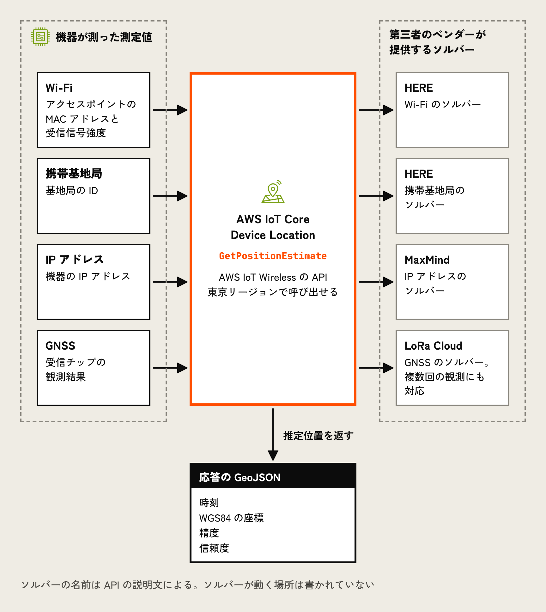
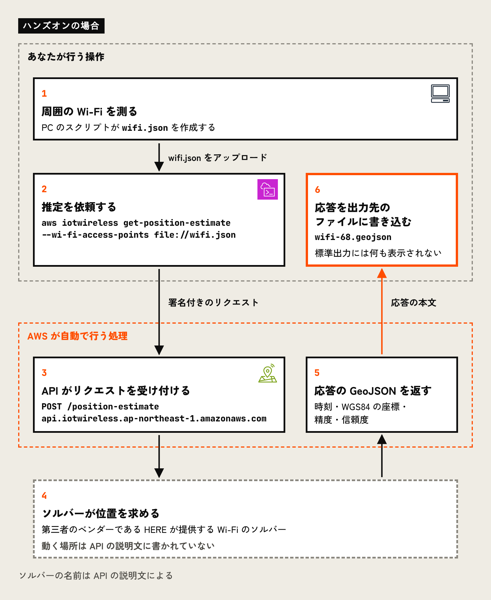
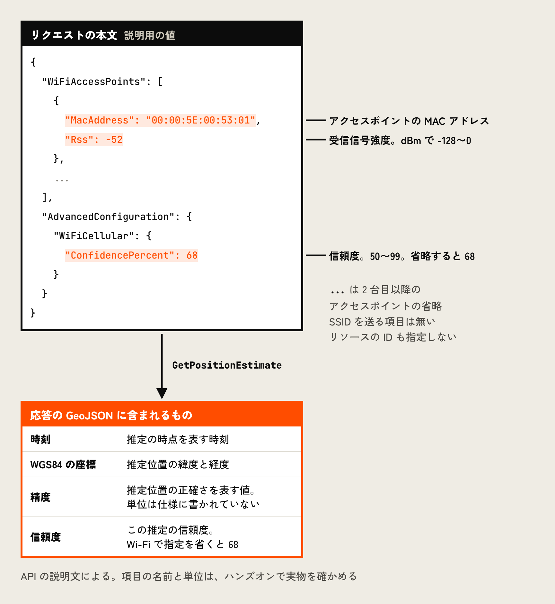
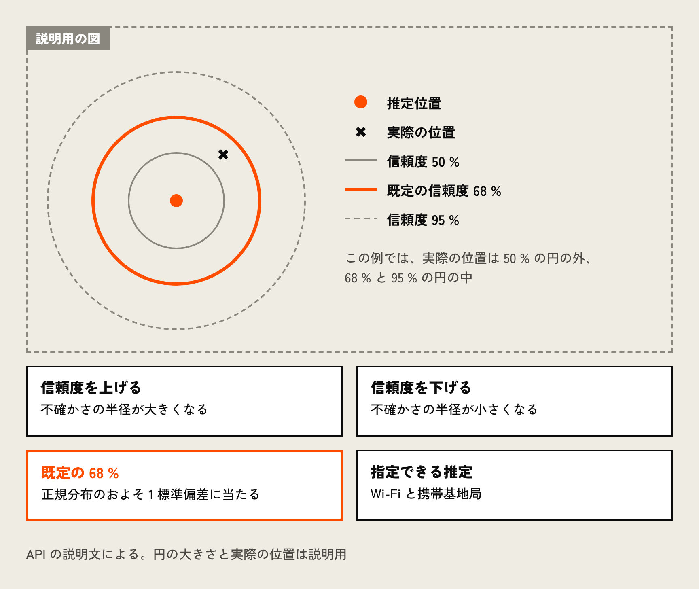
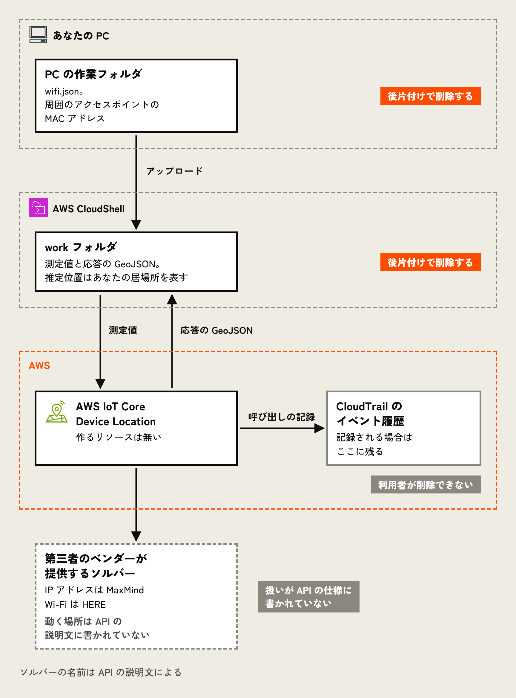
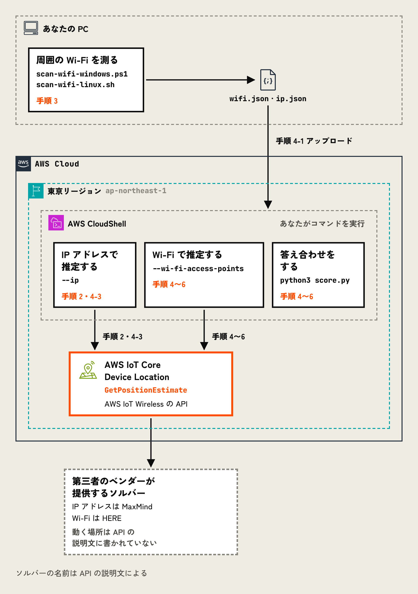

:::note info
AWS Deep Cuts の GitHub はこちらです。
https://github.com/AWS-Deep-Cuts/AWS-Deep-Cuts
:::

# AWS Deep Cutsとは？
AWS Deep Cutsは、AWS の最新のサービスやニッチな機能、または高度にアカデミックな知識を要求するサービスなど、多くの人が知らない 『隠れた名曲 = **Deep Cuts**』 を深くまで掘り下げる技術シリーズです。

このようなサービスはWeb情報も少なく、初学者は気軽にキャッチアップできないのが実情です。

そこで AWS Deep Cuts シリーズでは、**前提知識も含めた分かりやすいサービス解説** と **手順通りに進めれば誰でも再現できるハンズオン** を提供します！

# そもそもGPSを使わない位置の推定とは？
スマートフォンの地図アプリで現在地を表示すると、青い点の周りに、薄い色の円が表示されることがあります。屋外では小さかった円が、建物に入ると大きくなるのを見たことがある方も多いと思います。GPS の受信機を持たないノート PC でも、地図のサービスで現在地を表示すると、おおよその位置が同じような円と一緒に表示されることがあります。

この円は、表示された現在地がどのくらいずれている可能性があるかを表しています。スマートフォンや PC は、自分の位置を直接知っているわけではありません。周囲の電波などを測り、その値から位置を推し量っています。このように、測った値から位置を求めることを**位置の推定**と呼びます。円が大きいほど、現在地がずれている可能性のある範囲が広いことを表します。この円の半径を、**不確かさの半径**と呼びます。

位置の推定に使うために測った値を、**測定値**と呼びます。測定値には、主に次の 4 種類があります。

| 測定値 | 端末が測るもの |
| --- | --- |
| 衛星の電波 | GPS などの衛星から届く電波 |
| Wi-Fi のアクセスポイント | 周囲のアクセスポイントの識別番号と電波の強さ |
| 携帯電話の基地局 | 接続している基地局の ID |
| IP アドレス | インターネットに接続するときに使う IP アドレス |

GPS のように、衛星の電波で位置を求める仕組みを総称して、**GNSS** と呼びます。GNSS は Global Navigation Satellite System の略です。また、表のアクセスポイントは、Wi-Fi の電波を発信する機器です。家庭の無線 LAN のルーターも、アクセスポイントの 1 つです。

このうち Wi-Fi の測定値を、もう少し詳しく確認します。PC の Wi-Fi の一覧には、ネットワークの名前と、電波の強さを表す目盛りが表示されます。コマンドで詳しい一覧を表示すると、電波を発信しているアクセスポイントごとに、MAC アドレスと電波の強さも表示されます。**MAC アドレス**は、ネットワークの機器ごとに割り当てられた識別番号です。この一覧は、記事の最後で紹介するハンズオンの手順 3 で、自分の PC で確かめられます。

しかし、この一覧には、アクセスポイントがどこにあるかは含まれていません。そのため、測定値だけでは位置を計算できません。どの MAC アドレスのアクセスポイントがどこにあるかを知っている仕組みに、計算を任せる必要があります。

スマートフォンや PC では、多くの場合、OS や地図のサービスがこの計算を代わりに行います。では、自分で開発した機器の位置を知りたいときは、どうすればよいでしょうか。説明用の例として、荷物に取り付けて輸送中の位置を記録する、小さな機器を考えてみましょう。このように、インターネットにつながる機器を **IoT（Internet of Things）の機器**と呼びます。この機器も周囲の電波を測れますが、測定値だけでは位置を求められません。また、荷物の数は日によって変わり、位置を知りたいのは 10 分に 1 回程度です。機器が増えても減っても、位置を求めた分だけ費用を払えると扱いやすくなります。

こうした場面を考えると、機器の位置を推定するサービスには次の 3 つの条件が必要だと筆者は考えます。

| 条件 | 必要な理由 |
| --- | --- |
| 機器が測った測定値をそのまま渡せる | 機器の側で位置を計算しなくて済む |
| 推定した位置と一緒に、どのくらい確かかが分かる | 地図の円のように、ずれの可能性を考えて位置を使える |
| 使った分だけの料金で使える | 機器の数や、位置を求める回数に合わせて費用が決まる |

この 3 つの条件をすべて満たすと筆者が考えるサービスが、**AWS IoT Core Device Location** です。

# AWS IoT Core Device Locationとは？
AWS IoT Core Device Location は、機器の測定値を受け取り、推定した位置を返す AWS IoT Core の機能です。この記事では、AWS の SDK が持つ API の定義を **API の仕様**、その中に書かれた各 API の英語の説明を **API の説明文** と呼びます。どちらも、Python の AWS SDK と AWS CLI が使う botocore のモデルのファイルで読めます。AWS IoT Core の API の説明文によると、AWS IoT Core は、インターネットにつながる機器と AWS のクラウドの間で、安全な双方向の通信を提供するサービスです。Device Location の公式ドキュメントも、AWS IoT Core の開発者ガイドの中にあります。以降は、AWS IoT Core Device Location を **Device Location** と書きます。

Device Location に位置の推定を依頼する API は、`GetPositionEstimate` です。Device Location は、機器の測定値を受け取り、測定値の種類ごとに専門のベンダーの**ソルバー**で位置を求め、推定した位置を GeoJSON の形式で返します。ソルバーは、測定値から位置を計算する仕組みです。Device Location の全体像は、次の図のとおりです。



Device Location が受け取る測定値は、種類ごとに形が異なります。Wi-Fi の測定値は、アクセスポイントの MAC アドレスと受信信号強度の組です。**受信信号強度**は、受け取った電波の強さで、dBm という単位で表します。dBm は 1 ミリワットを基準にした電力の大きさの単位で、値が 0 に近いほど強い電波を表します。API の仕様では、受信信号強度は -128〜0 の整数で送ります。

携帯電話の基地局を、以降は**携帯基地局**と書きます。携帯基地局の測定値は、接続している基地局の ID です。API の仕様では、LTE を含む 5 つの通信方式の基地局の ID を送れます。IP アドレスの測定値は、IP アドレスの文字列 1 つです。GNSS の測定値は、機器が計算した緯度と経度ではありません。受信チップが衛星の電波から得た観測結果を 16 進数の文字列のまま送り、位置の計算はソルバーに任せます。

受け取った測定値からは、ソルバーが位置を求めます。API の説明文によると、ソルバーは第三者のベンダーが提供しており、測定値の種類ごとに使われるソルバーが異なります。ソルバーがどこで動くのかは、API の説明文には書かれていません。

位置を求めたあと、Device Location は応答を返します。応答は、**GeoJSON** の形式で書かれています。GeoJSON は、地理的なデータを JSON で表すための形式です。この応答を、**応答の GeoJSON** と呼びます。API の説明文によると、応答の GeoJSON には、時刻・WGS84 の座標・精度・信頼度が含まれます。WGS84 は、緯度と経度を表すときに使う世界共通の基準の 1 つです。応答の座標が示す位置を、**推定位置**と呼びます。精度と信頼度は、推定の確かさに関わる値です。API の説明文は、応答の精度が不確かさの半径にあたるのかを明記していません。ハンズオンでは、精度の値をメートル単位の不確かさの半径とみなして答え合わせをし、その見方が正しいかも実物で確かめます。信頼度は、仕組みの章で詳しく説明します。

Device Location には、以下のような特徴があります。

- **機器を登録せずに測定値だけで呼び出せる**
  API の仕様では、`GetPositionEstimate` のリクエストに、AWS IoT に登録した機器のような AWS のリソースを指定する項目がありません。必須の項目も無く、測定値を送るだけで位置の推定を依頼できます。そのため、Device Location を使うために、AWS のリソースを作成する必要はありません。
- **測定値の種類ごとに専門のベンダーのソルバーが位置を求める**
  API の説明文によると、Wi-Fi と携帯基地局は HERE、IP アドレスは MaxMind が提供するソルバーで位置を求めます。GNSS は、LoRa Cloud が提供する GNSS のソルバーで位置を求めます。どの測定値を送る場合も、呼び出す API は同じ `GetPositionEstimate` です。
- **推定の信頼度を指定できる**
  AWS CLI の変更履歴によると、2026 年 4 月から、Wi-Fi と携帯基地局の推定では**信頼度**を指定できるようになりました。信頼度は、推定の確かさを百分率で表す値です。信頼度によって、不確かさの半径の大きさが変わります。詳しくは、仕組みの章で説明します。
- **複数回の GNSS の観測をまとめて送れる**
  AWS CLI の変更履歴によると、2026 年 9 月に、同じ機器の GNSS の観測を 2・4・8・16・32 回分まとめて送る `GnssMultiFrame` が追加されました。変更履歴は、複数回の観測を組み合わせることで位置の精度が上がると説明しています。API の仕様では、1 回分の観測を送る `Gnss` と `GnssMultiFrame` は、同時には使えません。
- **API は AWS IoT Wireless に属する**
  Device Location は AWS IoT Core の機能ですが、`GetPositionEstimate` は、AWS IoT Core の API ではなく AWS IoT Wireless の API に含まれています。そのため、AWS CLI のコマンドは `aws iot` ではなく `aws iotwireless` で始まります。API の説明文によると、AWS IoT Wireless の API は、LoRaWAN と Amazon Sidewalk の機器を AWS IoT に接続するための API です。LoRaWAN と Amazon Sidewalk は、どちらも IoT の機器が使う無線通信の方式です。
- **料金は位置 1 件ごと**
  AWS の価格表である AWS Price List によると、東京リージョンでは、最初の 100 万件まで位置 1 件あたり 0.001 USD です。AWS のリソースを作成しないため、時間に比例する料金はありません。料金は、仕組みの章で詳しく説明します。
- **東京リージョンで呼び出せる**
  AWS の SDK が持つエンドポイントの一覧には、この API の東京リージョンのエンドポイントが含まれています。AWS Price List にも、東京リージョンの位置の単価が載っています。そのため、東京リージョンで呼び出せます。

:::note info
**Device Location の経緯**
AWS CLI の変更履歴に記録された、位置に関わる API の主な追加と変更は、次のとおりです。時期は、SDK と AWS CLI に変更が公開された時期です。AWS が機能を発表した日付とは、数日ずれることがあります。

| 時期 | 出来事 |
| --- | --- |
| 2022 年 7 月 | LoRaWAN の機器の位置を求める Positioning Service の 5 つの API が追加された。2023 年にアーカイブされた当時の公式ドキュメントは、この機能をプレビューと書き、Semtech が提供する GNSS のソルバーだけが使えるとしていた。5 つの API は、今はすべて廃止されている |
| 2022 年 11 月下旬 | `GetPositionEstimate`・`GetResourcePosition`・`UpdateResourcePosition` の 3 つの API が追加された |
| 2025 年 11 月 | Amazon Sidewalk のネットワークと Device Location が統合された |
| 2026 年 4 月 | Wi-Fi と携帯基地局の推定で、信頼度を指定できるようになった |
| 2026 年 9 月 | `GnssMultiFrame` が追加された |

Device Location の API が AWS IoT Wireless の API に含まれているのは、LoRaWAN の機器の位置の機能から始まったこの経緯のためだと、筆者は考えます。
:::

# 仕組み
この章では、ハンズオンで使う Wi-Fi の測定値を例に、AWS IoT Core Device Location の 1 回の位置の推定で何が起きるのかを順に説明します。実際の機器では、機器か、機器のデータを受け取るサーバーが、同じ `GetPositionEstimate` を呼び出します。この章では、記事の最後で紹介するハンズオンと同じく、あなたの PC で測った測定値を **AWS CloudShell** から送る例で説明します。AWS CloudShell は、ブラウザから AWS CLI のコマンドを実行できる AWS の環境です。

## 1 回の位置の推定で起きること
次の図は、ハンズオンの場合の 1 回の位置の推定を、処理の順に示しています。図の左の枠はあなたが行う操作、右の枠は AWS が自動で行う処理です。図の番号は、下の説明の番号と対応しています。



1. あなたの PC で周囲の Wi-Fi を測り、測定値を `wifi.json` というファイルにまとめます。ハンズオンでは、PC で実行するスクリプトがこのファイルを作成します。
2. CloudShell で AWS CLI のコマンドを実行し、推定を依頼します。CloudShell は AWS の側で動いているため、あなたの周囲の Wi-Fi は測れません。そこで、1 で作成した `wifi.json` を CloudShell にアップロードしてから、コマンドを実行します。
3. AWS CLI は、HTTPS のリクエスト `POST /position-estimate` を、東京リージョンのエンドポイント `api.iotwireless.ap-northeast-1.amazonaws.com` に送ります。このリクエストには、AWS CLI があなたの認証情報から計算した署名が付いています。このようなリクエストを**署名付きのリクエスト**と呼び、AWS は署名で、誰が送ったリクエストかを確かめます。AWS IoT Wireless の API が、このリクエストを受け付けます。
4. API の説明文によると、Wi-Fi の測定値からは、HERE が提供する Wi-Fi のソルバーが位置を求めます。
5. Device Location が、推定位置を含む応答の GeoJSON を返します。
6. AWS CLI は、応答の GeoJSON を、コマンドで指定したファイルに書き込みます。標準出力、つまり CloudShell の画面には、何も表示されません。筆者が AWS CLI 2.39.4 で確かめたところ、コマンドは何も表示せずに終わり、応答は指定したファイルに書き込まれていました。

図の 2 で実行する AWS CLI のコマンドは、次のとおりです。

```bash
aws iotwireless get-position-estimate wifi-68.geojson \
  --wi-fi-access-points file://wifi.json \
  --region ap-northeast-1
```

`--wi-fi-access-points` には、アクセスポイントの一覧を指定します。`file://wifi.json` は、ファイル `wifi.json` の中身を値として渡す書き方です。コマンド名 `get-position-estimate` の直後の `wifi-68.geojson` は、応答の GeoJSON を書き込むファイルの名前です。このファイルを、**出力先のファイル**と呼びます。

多くの AWS CLI のコマンドは、応答を JSON で画面に表示します。一方、`get-position-estimate` は、応答を出力先のファイルに書き込みます。API の仕様では、`GetPositionEstimate` の応答の本文が、GeoJSON のデータそのものだからです。AWS CLI は、このように応答の本文がデータそのものである API では、応答を画面に表示せず、指定したファイルに書き込みます。そのため、この API のコマンドでは、出力先のファイルの名前が必須の引数です。名前を省くと、AWS CLI は `the following arguments are required: outfile` のエラーで止まります。Python の AWS SDK である boto3 で呼び出す場合も、応答の本文はデータそのものとして返るため、`read()` で読み出します。

:::note warn
**出力先のファイルの名前はコマンド名の直後に書く**
筆者が AWS CLI 2.39.4 で確かめたところ、出力先のファイルの名前を `--wi-fi-access-points` より後ろに書くと、AWS CLI はファイルの名前をアクセスポイントの一覧の要素として読み、`the following arguments are required: outfile` のエラーで止まります。間に `--region` を挟んでも、コマンドの最後に書いても、結果は同じです。`--ip` のように 1 つの値を取るオプションの後ろであれば通りますが、迷わないように、出力先のファイルの名前はコマンド名の直後に書くのが確実です。
:::

このコマンドで送られる本文と、返ってくる応答の GeoJSON に含まれるものは、次の図のとおりです。リクエストの本文の値は、説明用の値です。図の本文の `AdvancedConfiguration` は、信頼度を指定した場合の例です。上のコマンドは信頼度を指定していないため、実際に送られる本文には `AdvancedConfiguration` は含まれません。



リクエストの本文は JSON で、`WiFiAccessPoints` にアクセスポイントの一覧を書きます。API の仕様では、アクセスポイントごとに書くのは、MAC アドレスの `MacAddress` と受信信号強度の `Rss` の 2 つだけで、どちらも必須です。このほかに、API の仕様から次のことが分かります。

- `MacAddress` は、図の例のようなコロン区切りの他に、ハイフン区切りや区切りの無い形でも書けます。
- Wi-Fi のネットワークの名前である SSID を送る項目はありません。
- `AdvancedConfiguration` の中の `ConfidencePercent` は信頼度で、省略できます。次の節で説明します。
- 位置を求める時刻を、`Timestamp` で指定することもできます。省略すると、AWS がリクエストを受け取った時刻が使われます。

一方、応答の GeoJSON については、時刻・WGS84 の座標・精度・信頼度が含まれることが API の説明文に書かれているだけで、項目の名前と単位は API の仕様に書かれていません。筆者が確かめた応答の実物は、次のとおりでした。

- 応答は GeoJSON の `Point` で、`coordinates` は経度、緯度の順です。
- 精度は `properties` の `horizontalAccuracy` です。単位は応答に書かれていませんが、Wi-Fi の推定で数百、IP アドレスの推定で 10000 という値の大きさから、メートル単位の不確かさの半径と読めます。
- 信頼度は `horizontalConfidenceLevel` で、百分率ではなく 0〜1 の小数です。信頼度を指定しなかった場合は `0.68` でした。
- IP アドレスの推定の応答には、これらに加えて `country`・`state`・`city`・`postalCode` が含まれました。

:::note info
**コンソールで位置を推定する画面**
API の説明文は、応答の GeoJSON の詳しい説明と例として、公式ドキュメントの「コンソールで機器の位置を解決する（Resolve device location (console)）」のページを案内しています。実際に、東京リージョンの AWS IoT Core のマネジメントコンソールには、左のメニューの「テスト」の下に「デバイスの位置情報」があります。開くと「デバイスの場所」という題名の画面になり、JSON のペイロードデータを入力して「解決」を選ぶと、位置を推定できます。この画面の説明には、ソルバーが場所を提供しない場合は課金されないと書かれています。この記事とハンズオンでは、その画面は使わず、AWS CLI で位置の推定を行います。
:::

リクエストが受け付けられなかった場合は、AWS CLI がエラーを表示します。API の仕様で定義されている主なエラーは、次のとおりです。

| エラー | 返るとき |
| --- | --- |
| `ValidationException` | 入力が、API の仕様の制約を満たしていない |
| `AccessDeniedException` | 呼び出した利用者に、この操作を行う権限が無い |
| `ThrottlingException` | 許可された頻度を超えて呼び出した |

## 信頼度と不確かさの半径
冒頭で、地図アプリの現在地の周りの円の半径を、不確かさの半径と呼びました。Device Location の API の説明文にも、不確かさの半径にあたる uncertainty radius という言葉が出てきます。Device Location では、この半径の大きさを、リクエストで指定する信頼度で変えられます。

推定位置に対して、機器が実際にある場所を**実際の位置**と呼びます。次の図は、同じ推定位置について、信頼度 50 %・68 %・95 % の不確かさの半径を描いた説明用の図です。図のように、信頼度を上げると、不確かさの半径が大きくなります。この例では、実際の位置は 50 % の円の外にあり、68 % と 95 % の円の中にあります。



信頼度は、一般に、示した範囲に実際の値が入る見込みを百分率で表したものです。正規分布はばらつきを表す代表的な考え方で、標準偏差はそのばらつきの大きさを表します。

API の仕様と説明文から分かることは、次のとおりです。

- 信頼度は、リクエストの `AdvancedConfiguration` の `WiFiCellular` の中の `ConfidencePercent` に、50〜99 の整数で指定します。
- 信頼度を上げると不確かさの半径が大きくなり、下げると半径が小さくなって、より狭い範囲を示します。
- 信頼度を省略すると、68 が使われます。68 は、正規分布のおよそ 1 標準偏差に当たる値です。
- 指定できる範囲は 50〜99 です。上限を超える 100 を指定すると、AWS から `ValidationException` が返ります。
- 応答の GeoJSON の信頼度の値は、指定した百分率ではなく 0〜1 の小数です。信頼度 68 の応答では `0.68` になります。
- 設定の名前が `WiFiCellular` で、説明文も Wi-Fi と携帯基地局の推定に限っているため、信頼度を指定できるのは Wi-Fi と携帯基地局の推定だけと読めます。IP アドレスや GNSS の推定で指定した場合にどうなるかは、API の仕様に書かれていません。

AWS CLI の変更履歴は、信頼度を指定する機能について、必要に応じて信頼度と不確かさの半径を引き換えられるようにするもの、と説明しています。つまり、確かさを重視するか、範囲の狭さを重視するかを、用途に合わせて選べます。選び方は、ベストプラクティスの章で説明します。

ただし、API の説明文は、信頼度で不確かさの半径の大きさが変わることは説明していますが、推定位置そのものが変わるかどうかは説明していません。ハンズオンでは、同じ測定値で信頼度 50・68・95 の推定を行い、応答のどの値が変わるかを確かめます。

## 料金
最後に、ここまでの位置の推定に、どのような料金がかかるのかを説明します。AWS Price List には Device Location という名前のサービスは無く、位置の推定の単価は AWS IoT の価格に含まれています。次の単価は、2026 年 11 月 1 日に取得した AWS Price List の、東京リージョンの値です。この単価は、2026 年 10 月 1 日から適用されています。

| 料金の要素 | かかるとき | 東京リージョンの単価 |
| --- | --- | --- |
| 位置の推定 | 位置 1 件ごと | 最初の 100 万件は 1 件 0.001 USD、100 万〜500 万件は 0.0008 USD、500 万件を超える分は 0.0007 USD |

AWS Price List では、課金の単位は、解決された位置 1 件です。単価は、Wi-Fi・携帯基地局・IP アドレス・GNSS のどの測定値でも同じです。AWS Price List に位置の推定の単価が載っている 7 つのリージョンでは、単価はすべて同じです。東京リージョンの価格には、位置の推定が 0 USD になる段はありません。

ただし、次のことは AWS Price List からは分かりません。

- 位置が求まらなかった呼び出しや、エラーになった呼び出しが、件数に数えられるか
- 100 万件と 500 万件の段を、どの期間の件数で数えるか

説明用の例として、冒頭の荷物の機器が 10 分に 1 回、位置を求める場合を計算します。1 台の機器の 30 日分の件数は、6 件 × 24 時間 × 30 日で 4,320 件です。すべての呼び出しが位置 1 件と数えられた場合、1 台あたりの料金は 4,320 件 × 0.001 USD で 4.32 USD です。Device Location では AWS のリソースを作成しないため、呼び出していない間に料金はかかりません。

:::note info
**MQTT で依頼する場合の料金**
AWS Price List には、この記事で説明している HTTPS の API の他に、MQTT で位置の推定を依頼する場合の単価も載っています。MQTT は、IoT の機器が AWS IoT Core とメッセージを送受信するときに使う通信の方式です。MQTT で依頼する場合も位置の単価は同じですが、AWS IoT Core のメッセージや接続の料金が別にかかると考えられます。東京リージョンでは、メッセージは月 10 億件まで 100 万件あたり 1.20 USD、接続は接続している時間 100 万分あたり 0.096 USD です。1 回の依頼が何件のメッセージと数えられるかは、AWS Price List からは分かりません。
:::

# AWS IoT Core Device Locationの主な活用事例
ここまでで、AWS IoT Core Device Location が、測定値だけを受け取って位置を推定し、推定位置を精度と信頼度と一緒に返すことを説明しました。この特徴を生かせる場面を、測定値の種類ごとに紹介します。次の使い方は、API の仕様と AWS CLI の変更履歴をもとに、筆者が整理したものです。

- **GNSS の受信機を持たない機器の位置を知る**
  Wi-Fi のアクセスポイントを測れる機器であれば、周囲のアクセスポイントの MAC アドレスと受信信号強度を送るだけで、推定位置を受け取れます。
- **携帯回線の機器の位置を知る**
  携帯電話の回線でインターネットに接続する機器は、接続している携帯基地局の ID を送ります。たとえば LTE の場合、API の仕様で必須の項目は `Mcc`・`Mnc`・`EutranCid` の 3 つです。API の説明文によると、`Mcc` は国を表すコード、`Mnc` は通信事業者のネットワークを表すコード、`EutranCid` は基地局が受け持つ区域であるセルを識別する ID です。
- **GNSS の計算をクラウドの側で行う**
  GNSS の受信チップが測った観測結果を 16 進数の文字列で送り、位置の計算はソルバーに任せます。AWS CLI の変更履歴によると、2026 年 9 月に追加された `GnssMultiFrame` で複数回の観測をまとめて送ると、位置の精度が上がります。
- **IP アドレスだけで位置を推定する**
  Wi-Fi や携帯基地局を測れない機器でも、インターネットに接続していれば、IP アドレスを送って推定位置を受け取れます。IP アドレスの推定と Wi-Fi の推定で精度の値がどう違うかは、ハンズオンで比べられます。
- **LoRaWAN と Amazon Sidewalk の機器の位置を管理する**
  AWS IoT Wireless の API で登録した LoRaWAN と Amazon Sidewalk の機器では、機器ごとに Device Location の機能を有効にするかどうかを設定できます。登録した機器の位置は、`GetResourcePosition` API で読み取り、`UpdateResourcePosition` API で書き換えられます。
- **求めた位置を地図や追跡に使う**
  AWS IoT Core のルールは、機器から届いたメッセージを処理し、他の AWS のサービスに渡す設定です。ルールの Amazon Location のアクションを使うと、MQTT のメッセージに含まれる位置を、Amazon Location Service のトラッカーに送れます。Amazon Location Service は地図や位置の追跡などの機能を提供する AWS のサービスで、トラッカーは機器の位置を更新して保存するリソースです。このアクションは Device Location とは別の機能ですが、Device Location で求めた位置を地図に表示したり、移動の記録に使ったりするときに組み合わせられます。

# AWS IoT Core Device Locationを使う際のベストプラクティス
ここまでの仕組みと料金を踏まえて、AWS IoT Core Device Location を使うときに守りたいことを挙げます。すべて、API の仕様と AWS Price List を踏まえた筆者の考えです。

最初に、送った測定値と返ってきた推定位置の行き先を確認します。次の図は、ハンズオンで送った測定値と推定位置が、どこに渡り、どこに残るかを示しています。



あなたの PC と CloudShell に残るファイルは、ハンズオンの後片付けで削除します。一方、AWS に送った測定値は、API の説明文によると、第三者のベンダーのソルバーで処理されます。その後の測定値の扱いは、API の仕様に書かれていません。また、AWS の API の呼び出しを記録するサービスである **AWS CloudTrail** には、直近の記録をコンソールで確認できるイベント履歴があります。筆者が確かめたところ、`GetPositionEstimate` の呼び出しはイベントソース `iotwireless.amazonaws.com` としてイベント履歴に記録され、記録のリクエストのパラメータには、送った IP アドレスや MAC アドレスと受信信号強度がそのまま含まれていました。イベント履歴に表示されるのは過去 90 日間の記録で、記録に含まれる値は、利用者が削除できません。

- **測定値と応答を場所に結び付く情報として扱う**
  Wi-Fi の測定値は、周囲のアクセスポイントの MAC アドレスそのものです。自分のルーターだけでなく、近隣のアクセスポイントの MAC アドレスも含まれます。また、応答の推定位置は、測定値を測った場所を表します。自宅で測れば、自宅の位置が返ります。測定値と応答を保存する場合は、保存する場所と期間、見られる人を決めておきます。
- **測定値の扱いを公式ドキュメントで確かめてから本番で使う**
  API の説明文によると、測定値は第三者のベンダーのソルバーで処理されます。保存の期間や処理の場所は、API の仕様に書かれていません。本番で使う前に、Device Location の公式ドキュメントで、測定値の扱いを確かめます。
  <!-- 要確認: C-14。Device Location のドキュメントのデータの扱いの記述を確かめ、書かれていれば「公式ドキュメントによると」で 1 文足す -->
- **用途に合わせて信頼度を選ぶ**
  信頼度は、不確かさの半径の大きさを決める値です。たとえば、配送先に着いたかどうかの判定のように、範囲から外れることを避けたい用途では、信頼度を高くして広い範囲で判定します。地図の上で推定位置の周りを小さく表示したい用途では、信頼度を低くします。
- **1 回のリクエストに入れる測定値の種類を決めておく**
  API の仕様では、1 回のリクエストに複数の種類の測定値を入れられます。しかし、種類を組み合わせたときにどのソルバーの結果が返るのかと、何件と数えられるのかは、API の仕様からは分かりません。AWS Price List には、Wi-Fi と携帯基地局を組み合わせた推定が、別の項目として載っています。単価は同じでも、組み合わせた推定が何件と数えられるかは分かりません。用途ごとに送る測定値の種類を決めておくと、結果と費用を見積もりやすくなります。
- **呼び出しの頻度から費用を見積もる**
  料金は位置 1 件ごとにかかるため、機器の数と、位置を求める頻度から費用を見積もります。また、許可された頻度を超えて呼び出すと `ThrottlingException` が返るため、再試行するときは間隔を空けます。
- **AWS CLI と SDK を新しく保つ**
  AWS CLI の変更履歴によると、信頼度の指定は AWS CLI 2.34.35 から、`GnssMultiFrame` は 2.36.48 から使えます。それより古い AWS CLI では、これらのオプションを指定できません。
- **API を呼び出す権限を絞る**
  AWS の権限を管理する IAM（AWS Identity and Access Management）のポリシーで許可するアクションは、`iotwireless:GetPositionEstimate` です。`iot:` ではなく `iotwireless:` で始まります。位置の推定が必要な IAM ユーザーや IAM ロールにだけ、このアクションを許可します。
  <!-- 要確認: C-11。Service Authorization Reference で、iotwireless:GetPositionEstimate のリソースの種類と条件キーを確かめ、権限の絞り方を具体的に書く -->

ベストプラクティスとは別に、答えの出ていない問いを 1 つ挙げます。Wi-Fi の測定値で自分の位置を求めると、自分のルーターだけでなく、近隣の人のアクセスポイントの MAC アドレスも、AWS とソルバーに送ることになります。送った測定値がソルバーの側でどう扱われるかは、API の仕様には書かれていません。自分の位置を求めるために、他人のアクセスポイントの情報を送ることを、どう考えればよいでしょうか。筆者にも、まだ答えはありません。ハンズオンでは少なくとも、自分が使ってよい場所でだけ測り、測定値と推定位置を公開しないことにしています。

# ハンズオンはこちら！
ここまでに説明した仕組みは、ハンズオンで確かめられます。ハンズオンでは、AWS CloudShell で AWS CLI のコマンドを 1 つずつ実行し、AWS IoT Core Device Location にあなたの居場所を推定してもらいます。まず、CloudShell 自身の IP アドレスで位置を推定します。次に、あなたの PC で測った Wi-Fi の測定値で推定し、推定位置と実際の位置を比べます。推定位置と実際の位置の距離を**ずれ**と呼び、ずれと不確かさの半径を見比べることを**答え合わせ**と呼びます。続けて、信頼度を 50・68・95 と変えて不確かさの半径を比べ、送るアクセスポイントの数を減らすと結果がどう変わるかも確かめます。

Wi-Fi の測定値には、近隣のアクセスポイントの MAC アドレスも含まれます。そのため、測るのは自宅や自分の職場など、あなたが使ってよい場所だけにしてください。推定位置の座標と MAC アドレスは、公開しないでください。

ハンズオンでは、AWS のリソースを作成しません。AWS を呼び出すのは手順どおりで最大 10 回です。呼び出し 1 回を位置 1 件と数えると、費用は最大で約 0.010 USD です。

ハンズオンの構成は、次の図のとおりです。図の手順の番号は、ハンズオンの README の手順の番号です。



https://github.com/AWS-Deep-Cuts/aws-iot-core-device-location

# まとめ
AWS IoT Core Device Location は、機器が測った測定値を送るだけで、推定位置とその確かさを返す AWS IoT Core の機能です。冒頭で挙げた 3 つの条件と、それぞれを満たす Device Location の仕組みは、次のとおりです。

| 条件 | Device Location の仕組み |
| --- | --- |
| 機器が測った測定値をそのまま渡せる | Wi-Fi・携帯基地局・IP アドレス・GNSS の測定値を `GetPositionEstimate` に送る。機器の登録は不要 |
| 推定した位置と一緒に、どのくらい確かかが分かる | 応答の GeoJSON に精度と信頼度が含まれる。Wi-Fi と携帯基地局では信頼度を 50〜99 で指定でき、信頼度で不確かさの半径の大きさが変わる |
| 使った分だけの料金で使える | 東京リージョンでは、最初の 100 万件まで位置 1 件 0.001 USD。作成するリソースが無く、呼び出さない間の料金はかからない |

地図アプリの円を見かけたら、その円が何を表しているのかを思い出してみてください。自分の居場所を AWS に当ててもらいたい方は、ぜひハンズオンで試してみてください！

---

参考文献
1. [コンソールで機器の位置を解決する（Resolve device location (console)）](https://docs.aws.amazon.com/iot/latest/developerguide/location-resolve-console.html)
1. [botocore の AWS IoT Wireless の API モデル（botocore: iotwireless 2020-11-22 service-2.json）](https://github.com/boto/botocore/blob/develop/botocore/data/iotwireless/2020-11-22/service-2.json)
1. [botocore の AWS IoT の API モデル（botocore: iot 2015-05-28 service-2.json）](https://github.com/boto/botocore/blob/develop/botocore/data/iot/2015-05-28/service-2.json)
1. [AWS CLI v2 の変更履歴（AWS CLI v2 CHANGELOG）](https://github.com/aws/aws-cli/blob/v2/CHANGELOG.rst)
1. [AWS Price List の AWS IoT の東京リージョンの価格（AWS Price List: AWSIoT, ap-northeast-1）](https://pricing.us-east-1.amazonaws.com/offers/v1.0/aws/AWSIoT/current/ap-northeast-1/index.json)
1. [GeoJSON の Web サイト（GeoJSON）](https://geojson.org/)
1. [アーカイブされた AWS IoT のドキュメントのソース（awsdocs/aws-iot-docs）](https://github.com/awsdocs/aws-iot-docs)
<!-- 要確認: 公開前に、GetPositionEstimate の API リファレンスと Device Location の開発者ガイドの目次のページの URL と英語の原題を確かめて足す。調査では docs.aws.amazon.com を開けていない -->
